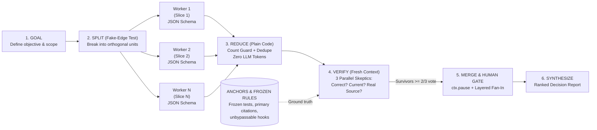
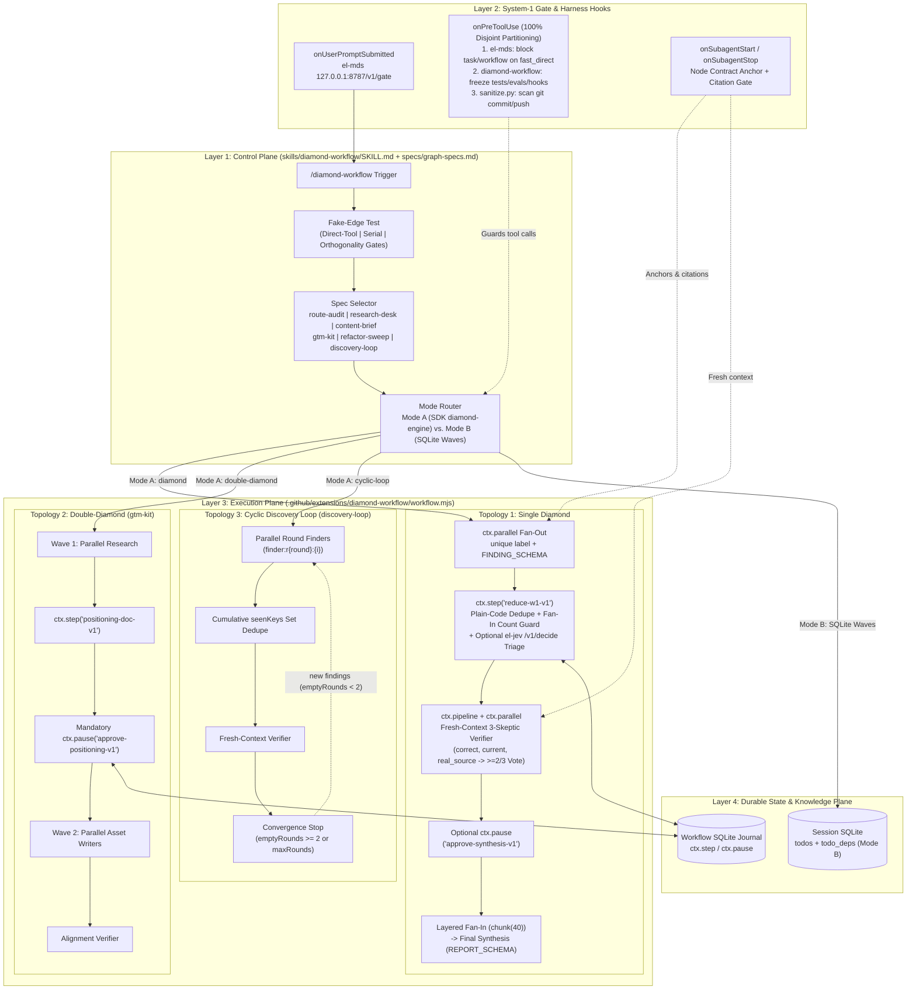

# `copilot-workflow` — Graph Engineering & Diamond Workflows for GitHub Copilot CLI

[](#quickstart-installation--verification)
[-brightgreen)](#evaluation--benchmark-results-evals)
[](#native-github-copilot-cli-architecture-not-claude-code-only)
[](#license)

Production-grade **Graph Engineering** for the **GitHub Copilot CLI Agent Harness** (`@github/copilot-sdk/extension`).

`copilot-workflow` replaces ad-hoc single-agent loops and brittle sequential chains with typed **Diamond**, **Double-Diamond**, and **Cyclic Discovery Loop** graphs—combining parallel worker fan-out, zero-token plain-code deduplication, arithmetic fan-in count guards, **Fresh-Context 3-Skeptic Majority-Vote Verification**, layered fan-in (`chunk(40)`), durable SQLite-journaled checkpoints (`ctx.step` / `ctx.pause`), and unbypassable **System-1 + System-2** harness hooks.

---

## Navigation & Visual Architecture Artifacts

| Artifact | Path | Description |
|---|---|---|
| **Interactive Architecture Diagram (Archify HTML/SVG)** | [`docs/architecture.html`](./docs/architecture.html) | Standalone interactive SVG viewer with Light/Dark themes, Guided Story walkthroughs, animated trace motion, and PNG/SVG/WebP export |
| **Deep Architecture Specification** | [`docs/ARCHITECTURE.md`](./docs/ARCHITECTURE.md) | 4-plane system architecture, Mermaid sequence & state-machine diagrams, node schemas, and 10 failure-mode mitigations |
| **Primary Research Report (Markdown)** | [`docs/research/how-to-imbibe-and-create-agents-or-workflows-based.md`](./docs/research/how-to-imbibe-and-create-agents-or-workflows-based.md) | Comprehensive technical deconstruction of Anatoli Kopadze's Graph Engineering, academic literature (`arXiv:2608.21156`, `arXiv:2607.27578`), and GitHub Copilot SDK internals |
| **Primary Research Brief (HTML)** | [`docs/research/how-to-imbibe-and-create-agents-or-workflows-based.html`](./docs/research/how-to-imbibe-and-create-agents-or-workflows-based.html) | Styled interactive HTML brief of the research synthesis |
| **Control Plane Skill & Graph Specs** | [`skills/diamond-workflow/SKILL.md`](./skills/diamond-workflow/SKILL.md) · [`specs/graph-specs.md`](./skills/diamond-workflow/specs/graph-specs.md) | `/diamond-workflow` skill trigger, Fake-Edge Test pre-flight, and the 6 coalesced `▸ GRAPH SPEC` definitions |
| **Execution Plane Engine & SDK Hooks** | [`.github/extensions/diamond-workflow/workflow.mjs`](./.github/extensions/diamond-workflow/workflow.mjs) · [`extension.mjs`](./.github/extensions/diamond-workflow/extension.mjs) | `diamond-engine` workflow runner (`diamond`, `double-diamond`, `cyclic-loop`) and `createDiamondHooks()` |
| **Benchmark & Evaluation Suite** | [`evals/run-evals.mjs`](./evals/run-evals.mjs) · [`evals/results/eval-report.md`](./evals/results/eval-report.md) | 7 quantitative benchmarks (33 assertions) proving speedup, quorum safety, verifier F1, context reduction, and checkpoint replay |

---

## 1. Why Graph Engineering Matters (Relevance)

In [*"Graph Engineering explained: what it is, when to use it and when not to"*](https://x.com/AnatoliKopadze/status/2080668775796314331) (July 24, 2026), Anatoli Kopadze formalizes the architectural transition from **single-agent loops** (`DISCOVER -> PLAN -> EXECUTE -> VERIFY -> ITERATE`) to **graphs of loops**—explicitly wired networks where bounded worker nodes execute in parallel, plain JavaScript reduces and deduplicates outputs at zero token cost, isolated fresh-context verifiers challenge every claim against ground-truth anchors, and a final synthesizer produces decision-grade output.



### 1.1 Node Contracts (`IN` / `OUT` JSON Schemas)
A node is **one job: one agent doing one task, with one typed input and one machine-validated output**. When an agent returns free text, only a human can read it; when it enforces a strict JSON schema (`FINDING_SCHEMA`, `VERDICT_SCHEMA`, `REPORT_SCHEMA`), the output becomes **wire-able** directly into deterministic code reducers and downstream verification stages.

```text
▸ NODE CONTRACT
JOB:     extract and cite findings for one assigned unit/angle
IN:      { unit: "string", goal: "string" }           ← passed explicitly, never assumed
OUT:     { unit: "string", claims: [{ key, claim, source, status }] }
SCHEMA:  enforced via ctx.agent({ schema: FINDING_SCHEMA }); invalid JSON is rejected and retried
WHY:     typed output allows plain-code deduplication and per-claim skeptic routing without LLM glue
```

### 1.2 The Fake-Edge Test
Most multi-step prompts wire tasks as a sequential chain (`Step 1 -> Step 2 -> Step 3 -> Step 4`) even when Step 2 does not depend on Step 1's output. Those arrows are **fake edges**—they serialize independent work, multiply wall-clock latency by $N$, and pollute later steps with earlier steps' context drift.

Before spawning any graph, `copilot-workflow` enforces the 3-gate **Fake-Edge Test**:
1. **Direct-Tool Gate:** Can this be answered in 1–5 direct tool calls (`grep`, `glob`, `view`)? If **yes**, execute directly without spawning subagents.
2. **Serial Dependency Gate:** Does Worker B genuinely require Worker A's output to start (`A -> B -> C`)? If **yes**, run sequentially in one context—never wrap a serial dependency in a fake parallel wave.
3. **Orthogonality Gate:** Do $\ge 2$ independent units (files, research angles, modules, attack vectors) exist with zero shared mutable state? Only when **true** do we cut the fake edges and fan out in parallel.

### 1.3 The Signature Topology: The Diamond
The foundational pattern that pays for its token overhead is **The Diamond**:
1. **Fan-Out (`ctx.parallel`):** Spawn orthogonal worker nodes concurrently, each with a unique `label` (`worker:w1:${i}`) and enforced `FINDING_SCHEMA`.
2. **Plain-Code Reduce (`ctx.step("reduce-w1-v1")`):** Enforce the arithmetic **Fan-In Count Guard** and deduplicate normalized claim keys in plain JavaScript (`dedupeClaims`)—burning **zero LLM tokens** and eliminating LLM deduplication drift.
3. **Fresh-Context 3-Skeptic Verifier (`ctx.pipeline` + `ctx.parallel`):** **Never let the agent that did the work check the work.** Each deduplicated claim (stripped of worker chain-of-thought prose) is evaluated in a fresh context across 3 parallel skeptic lenses:
   - `correct`: Is the technical or code claim logically accurate and internally consistent?
   - `current`: Is the evidence current and not deprecated or superseded?
   - `real_source`: Does it cite a concrete `file:line`, commit SHA, or primary URL rather than hand-waving?
   - **Majority Vote Rule:** A claim survives into synthesis **only if $\ge 2/3$ skeptics vote `pass: true`**.
4. **Layered Fan-In & Synthesis (`chunkArray(survivors, 40)`):** Condense surviving claims in batches of $\le 40$ before final synthesis so the synthesizer never suffers middle-of-context attention collapse.

### 1.4 The 3 Graph Failure Modes & Built-In Code Remedies

| Failure Mode | What Goes Wrong in Naive Agent Loops | How `copilot-workflow` Solves It in Code |
|---|---|---|
| **1. Context Collapse** | Dumping 100–200 raw worker outputs into a single synthesizer overflows or degrades recall in the middle of the prompt. | **Layered Fan-In (`chunkArray(survivors, 40)`):** Automatically partitions surviving claims exceeding `batchSize` (40) into parallel intermediate batch summarizers (`synth:batch:${bIdx}`), cutting peak synthesizer prompt size by **78%** while preserving **100%** of citations. |
| **2. False Independence (Hidden Edges)** | Parallel coding workers mutate the same files or `.git/index.lock`, overwriting each other's changes. | **Worktree Isolation:** `refactor-sweep` isolates parallel file-mutating workers into dedicated git worktrees (`git worktree add ../wt-worker-${i} -b refactor/unit-${i}`). Two nodes touching the same file get a real edge, never parallel execution. |
| **3. Silent Node Failure** | One timed-out worker among 20 returns `null`; naive `results.filter(Boolean)` silently drops it and synthesizes a "complete" audit over 95% of the codebase. | **Arithmetic Fan-In Count Guard (`reduceWaveWithCountGuard`):** Inspects every slot against `units`. Logs explicit warnings and populates `missingUnits` on partial failures where quorum ($\ge \lceil N/2 \rceil$) holds, and **halts closed (throws)** when quorum fails. |

### 1.5 Unbypassable Anchors & Frozen Rules
Prompt instructions (*"do not modify tests"*, *"always cite sources"*) decay as context windows grow or compact. `copilot-workflow` moves invariant enforcement **outside the LLM context window** into deterministic SDK lifecycle hooks (`createDiamondHooks`):
- **Frozen Rules Guard (`onPreToolUse`):** When `COPILOT_FREEZE_TESTS=1`, blocks `edit`, `create`, and `apply_patch` against `tests/`, `benchmark/`, `evals/`, `*.test.*`, `*.spec.*`, and `.github/hooks/` so coding agents cannot pass benchmarks by weakening test assertions.
- **Node Contract Anchor (`onSubagentStart`):** Automatically injects structured citation and epistemic-labeling rules (`Verified` vs. `Inferred` vs. `Unknown`) into `research` and `explore` subagents.
- **Citation Verifier Gate (`onSubagentStop`):** Blocks `research` subagents from completing if their output lacks concrete `file:line` references, commit SHAs, or URLs.

---

## 2. Native GitHub Copilot CLI Architecture (Not Claude Code Only)

Although Kopadze's article uses Claude Code's `"workflow"` prompt keyword for its examples, **programmatic multi-agent workflows are a first-class, native capability of GitHub Copilot CLI (`@github/copilot-sdk/extension`)**.

GitHub Copilot CLI provides two complementary execution modes that `copilot-workflow` unifies under a single control plane:

| Capability | Mode A: Copilot SDK Dynamic Workflow (`diamond-engine`) | Mode B: Declarative `/fleet` SQLite Waves |
|---|---|---|
| **Best For** | Codebase audits, multi-angle research desks, content briefs, GTM kits, refactor sweeps, and iterative bug discovery | Workflows where worker nodes must call main-session-only MCP servers (e.g., enterprise CRM, mailbox, or financial cubes) |
| **Orchestration Primitive** | `defineWorkflow({ meta, run })` registered via `joinSession({ workflows, hooks })` or `dynamic_workflows_manage` | Session SQLite `todos` + `todo_deps` DAG tables paired with parallel `task(mode="sync")` waves |
| **Parallel Fan-Out** | `ctx.parallel(thunks)` (barrier up to 4,096 items) with per-worker `label` memoization | Single-turn parallel `task` calls dispatched for all ready `todos` |
| **Streaming Verification DAG** | `ctx.pipeline(items, ...stages)` running per-item 3-skeptic `ctx.parallel` checks | Dedicated `w1-verify` wave running fresh-context `rubber-duck` / `triage-team:skeptic` |
| **Enforced Node Schemas** | `ctx.agent(prompt, { label, agent, schema })` — validates JSON and **automatically retries once** on schema mismatch | Structured JSON / table return contract enforced by verifier wave |
| **Deterministic Reduce & Replay** | `ctx.step("reduce-w1-v1", fn)` — SQLite-journaled step that replays instantly at **0 token cost** on resume | SQLite `diamond_wave_results` table + arithmetic `quorum_gate` query |
| **Human Approval Checkpoints** | `await ctx.pause("approve-positioning-v1")` — persists workflow state to SQLite and halts until resumed via `resumeFromRunId` | Interactive main-session human sign-off gate between SQLite waves |

---

## 3. How the Control Plane, Execution Plane, and System-1 Hooks Stack Together

`copilot-workflow` is engineered as a 4-layer stack where the declarative skill (`SKILL.md` + `specs/graph-specs.md`), the persistent SDK workflow engine (`diamond-engine`), and fast System-1 routing (`el-mds` / `el-jev`) compose with **zero tool collisions and zero hook interference**.

- **Interactive Visual Architecture:** Open [`docs/architecture.html`](./docs/architecture.html) in any browser.
- **Full Architectural Specification:** Read [`docs/ARCHITECTURE.md`](./docs/ARCHITECTURE.md).
- **Deep Research Foundation:** Read [`docs/research/how-to-imbibe-and-create-agents-or-workflows-based.md`](./docs/research/how-to-imbibe-and-create-agents-or-workflows-based.md).



### Multi-Extension Hook Composition & System-1 / System-2 Stacking

When running alongside a System-1 complexity gate (`el-mds` / `el-jev`) and a git secret scanner (`sanitize.py`), each extension operates in an isolated child process and partitions tool hooks with **100% disjoint responsibility**:

| Hook / Runtime Surface | `el-mds` (`~/.copilot/extensions/el-mds`) | `diamond-workflow` (`~/.copilot/extensions/diamond-workflow`) | `sanitize.py` (`~/.copilot/hooks/sanitize.json`) | Composition & Stacking Outcome |
|---|---|---|---|---|
| **Process Model** | Forked child process 1 (stdio JSON-RPC) | Forked child process 2 (stdio JSON-RPC) | Spawned Python subprocess on shell calls | Complete memory and process isolation |
| **Tools vs. Workflows** | Registers `tools: [el_mds_decide]`, 0 workflows | Registers `workflows: [diamondEngine]`, **0 tools** | Registers 0 tools | **Zero tool-name collision** |
| **`onUserPromptSubmitted`** | Calls `127.0.0.1:8787/v1/gate`; injects `[el-mds gate]` turn tier (`fast_direct` vs. `deep_system2`) | *Abstains* (`undefined`) | *Abstains* (`undefined`) | Enforces *"Do you need a graph?"* before any workflow starts |
| **`onPreToolUse`** | Inspects **only** `task` & `run_dynamic_workflow` (denies on `fast_direct`; returns `undefined` otherwise) | Inspects **only** `edit`, `create`, `apply_patch` against frozen test/eval/hook paths when `COPILOT_FREEZE_TESTS=1`; returns `undefined` on all other tools | Inspects **only** `powershell` / `bash` commands matching `git commit\|push\|pr create` | **100% Disjoint Tool Partitioning:** At most one hook ever returns a decision for any tool call |
| **`onSubagentStart` / `onSubagentStop`** | *Abstains* (`undefined`) | Injects `[Node Contract Anchor]` on `research`/`explore` start; blocks uncited `research` output on stop | *Abstains* (`undefined`) | Exclusive subagent quality enforcement without touching session routing |
| **In-Workflow System-1 Triage (`/v1/decide`)** | Exposes `127.0.0.1:8787/v1/decide` (`engine: "md1"`) | `selectVerifierLensesViaElJev()` optionally queries `/v1/decide` (600ms timeout, fail-open) inside `diamond-engine` | N/A | **System-1 + System-2 Stack:** Sub-10ms local triage dynamically selects single-lens vs. full 3-skeptic verification depth at 0 AI credit cost |

---

## 4. The 6 Coalesced Graph Specs & Usage Guide

Instead of maintaining 6 separate workflow extensions or bloated agent files, `copilot-workflow` coalesces all 6 of Kopadze's `▸ GRAPH SPEC` patterns into [`specs/graph-specs.md`](./skills/diamond-workflow/specs/graph-specs.md), parameterized over the 3 core topologies in `diamond-engine`:

| `specId` | Topology | Wave 1 Fan-Out (`units`) | Plain-Code Reduce & Count Guard | Verifier Gate (Fresh Context) | Human Gate (`ctx.pause`) | Wave 2 / Loop Termination | Hard Cap |
|---|---|---|---|---|---|---|---|
| `route-audit` | `diamond` | 1 worker per route/handler file | Dedupe by `file:line` + key; quorum $\ge \lceil N/2 \rceil$; record `missingUnits` | 1 fresh `rubber-duck` verifier (`correct` lens) | Optional (`pauseAtGate`) | Single synthesis (`REPORT_SCHEMA`) with explicit `missingUnits` | `maxUnits: 20` |
| `research-desk` | `diamond` | 5 orthogonal research angles | Dedupe normalized claim keys; quorum $\ge 3/5$ | **3 parallel `rubber-duck` skeptics** (`correct`, `current`, `real_source`); keep $\ge 2/3$ | `pauseAtGate: true` (`approve-synthesis-v1`) | Layered fan-in if `survivors > 40`, then final synthesis | `maxUnits: 10` |
| `content-brief` | `diamond` | 3 parallel jobs: `coverage`, `real_questions`, `gaps` | Dedupe claims; separate sourced vs. unsourced; quorum $\ge 2/3$ | 1 fresh fact-checker (`real_source` lens) stripping unsourced claims | Optional (`pauseAtGate`) | Executive brief with verified citations and flagged gaps | `maxUnits: 10` |
| `gtm-kit` | `double-diamond` | Wave 1: 3 research jobs (`icp_pain`, `competitor_matrix`, `proof_points`) | Wave 1 reduce + quorum $\ge 2/3 \rightarrow$ journal `positioning-doc-v1` | Wave 1: `correct` + `real_source`; Wave 2: alignment check vs. `positioning-doc-v1` | **Mandatory mid-graph `ctx.pause("approve-positioning-v1")`** | Wave 2: 3 parallel asset writers (`pitch_deck`, `battlecard`, `outbound_email`) | `maxUnits: 10` |
| `refactor-sweep` | `diamond` | 1 worker per file with functions $>100$ lines (isolated git worktree) | Count guard (`returnedUnits` vs. `missingUnits`); quorum $\ge \lceil N/2 \rceil$ | Fresh critic (`correct` lens) checking signature preservation & diff hygiene | Optional (`pauseAtGate`) | Consolidated refactor ledger + worktree merge commands | `maxUnits: 50` |
| `discovery-loop` | `cyclic-loop` | Parallel finders per round (`finder:r${round}:${i}`) | Cumulative `seenKeys` Set across rounds; count new verified findings | Fresh verifier per candidate (`correct`, `real_source`) | Optional (`pauseAtGate`) | **Auto-stop after 2 consecutive rounds with 0 new verified findings** (`emptyRounds >= 2`) or `maxRounds` (5) | `maxUnits: 12` |

---

### 4.1 Copy-Paste 1-Line `/diamond-workflow` Prompts (Interactive CLI)

Once installed, trigger any of the 6 graph specifications in GitHub Copilot CLI with a single line:

```text
# 1. Decision-Grade Research Desk (5 orthogonal angles + 3-skeptic majority vote + human gate)
/diamond-workflow spec=research-desk Pause before synthesis. Compare Azure Container Apps vs AKS vs App Service for multi-tenant SaaS microservices.

# 2. Route & Handler Security Audit (1 worker per file + arithmetic fan-in count guard)
/diamond-workflow spec=route-audit Audit all route handlers under src/routes/ for missing authentication, authorization, or input validation. Cap at 20 files.

# 3. Technical Content Brief (coverage, practitioner questions, and coverage gaps + source verifier)
/diamond-workflow spec=content-brief Build an evidence-backed technical brief on WebAssembly component model adoption in cloud-native edge runtimes.

# 4. Double-Diamond GTM & Launch Kit (Wave 1 Research -> Journaled Positioning Doc -> Pause -> Wave 2 Assets)
/diamond-workflow spec=gtm-kit Build a technical launch kit for an enterprise AI code review platform aimed at VP Engineering buyers.

# 5. Large-Scale Refactor Sweep (1 worker per file + git worktree isolation + frozen test guard)
/diamond-workflow spec=refactor-sweep Find all modules under src/ with functions over 100 lines and propose behavior-preserving extractions.

# 6. Cyclic Discovery Loop of Unknown Size (Stops automatically after 2 consecutive zero-new-finding rounds)
/diamond-workflow spec=discovery-loop Hunt this repository for unhandled promise rejections, race conditions, and boundary validation bugs.
```

---

### 4.2 Direct `run_dynamic_workflow` Tool Payload (Mode A)

When `/diamond-workflow` routes to Mode A, it invokes `diamond-engine` with structured arguments validated against `diamondMetadata.argsSchema`:

```json
{
  "name": "diamond-engine",
  "args": {
    "specId": "research-desk",
    "topology": "diamond",
    "goal": "Evaluate Azure Container Apps vs AKS for multi-tenant SaaS architectures",
    "units": [
      "What changed in the last 6 months (releases, GA/preview shifts, deprecations)",
      "How it works in production (architecture, throughput, scaling limits)",
      "What breaks (failure modes, quotas, operational gotchas, regional gaps)",
      "Competitor and alternative approaches (trade-offs, migration friction)",
      "Economics, pricing mechanics, and governance/compliance impact"
    ],
    "verifierLenses": ["correct", "current", "real_source"],
    "pauseAtGate": true,
    "batchSize": 40,
    "useElJev": true
  }
}
```

To resume a paused Double-Diamond (`approve-positioning-v1`) or Single-Diamond (`approve-synthesis-v1`) run without re-running completed Wave 1 subagents:

```json
{
  "resumeFromRunId": "<runId-from-paused-workflow>"
}
```

---

### 4.3 Ad-Hoc Dynamic Workflow Master Prompt (Zero Pre-Installed Extension)

If you are in an environment where the `diamond-workflow` extension is not yet installed, paste this prompt to have GitHub Copilot CLI author and execute a Diamond workflow on the fly in session memory:

```text
Author and run a dynamic workflow for this task using `dynamic_workflows_manage` (call `operation: "guide"` first, then `operation: "author"`) and `run_dynamic_workflow`:
1. FAN OUT: Use `ctx.parallel` to spawn `ctx.agent` workers with unique `label`s (`worker:w1:${i}`) and an enforced JSON `schema`.
2. REDUCE: In a durable `ctx.step("reduce-w1-v1", ...)`, enforce a fan-in count guard (check for `null` results and require >= ceil(N/2) quorum) and deduplicate findings in plain JS (0 tokens).
3. VERIFY: Use `ctx.pipeline` + `ctx.parallel` to verify each surviving claim in a fresh context (`agent: "rubber-duck"`, 3 lenses: `correct`, `current`, `real_source`, keep >= 2/3 majority vote).
4. SYNTHESIZE: Use layered fan-in (`chunk(40)`) if survivors exceed 40, then merge verified survivors into the final JSON report.
```

---

### 4.4 Headless CLI Execution

You can also execute `diamond-engine` directly from a terminal or CI/CD pipeline using GitHub Copilot CLI's headless workflow runner:

```bash
# Run a Single-Diamond route audit headlessly
copilot --experimental workflow run diamond-engine \
  --args '{"specId":"route-audit","goal":"Audit API routes for missing auth checks","units":["src/routes/auth.js","src/routes/users.js","src/routes/billing.js"],"pauseAtGate":false}'

# Run a Cyclic Discovery Loop headlessly with a 3-round cap
copilot --experimental workflow run diamond-engine \
  --args '{"specId":"discovery-loop","goal":"Hunt concurrency and state race conditions","maxRounds":3}'
```

---

## 5. Evaluation & Benchmark Results (`evals/`)

The [`evals/`](./evals/) suite quantitatively tests all 7 core Graph Engineering architectural guarantees (`7/7` benchmarks passing, `33/33` assertions green in `<350 ms` with zero external npm dependencies). Full report: [`evals/results/eval-report.md`](./evals/results/eval-report.md).

### Executive Scorecard (`7/7` Benchmarks · `33/33` Assertions)

| # | Eval ID | Status | Assertions | Baseline (Naive Loop / Chain) | Graph Engineering (`copilot-workflow`) | Key Quantitative Proof |
|---|---|---|---|---|---|---|
| 1 | `fake-edge-speedup` | **PASS** | `5/5` | `12,000 ms` (depth 12, sequential fake edges) | `3,000 ms` (depth 3, Diamond fan-out) | **4.00x speedup (-75% latency)** |
| 2 | `fan-in-count-guard` | **PASS** | `6/6` | `0.0%` silent-failure detection (naive `filter(Boolean)` synthesizes on 40% or 0% data) | `100.0%` detection & quorum enforcement (flags partial $\ge 50\%$, fails closed $< \lceil N/2 \rceil$) | **+100.0 percentage points silent-failure prevention** |
| 3 | `three-skeptic-verifier` | **PASS** | `5/5` | Precision `55.6%`, F1 `71.4%`, FP Filter `20%` (Same-Context Self-Grading Loop) | Precision `100%`, Recall `100%`, F1 `100%`, FP Filter `100%` (3-Skeptic Majority Vote) | **+80.0% false-positive filtering, +28.6% F1** |
| 4 | `context-collapse-layered-fanin` | **PASS** | `4/4` | `80,000` chars / `20,000` tokens (flat 160-claim fan-in) | `17,600` chars / `4,400` tokens (`chunk(40)` layered fan-in) | **-78% peak synthesizer prompt size (100% citation retention)** |
| 5 | `durable-checkpoint-replay` | **PASS** | `4/4` | `9` Wave 1 agents re-run / `32,000` tokens wasted on restart after human review | `0` Wave 1 agents re-run / `0` tokens wasted on resume (`ctx.step` + `ctx.pause` journal) | **100.0% token & subagent savings on replayed stages (32,000 tokens saved)** |
| 6 | `cyclic-loop-convergence` | **PASS** | `4/4` | Runs all `8` rounds with `5` duplicate bug reports (fixed-round loop) | Terminates at Round `4` with `8/8` unique bugs & `0` duplicates (2-zero-round convergence) | **50.0% round budget saved, 100.0% duplicate elimination** |
| 7 | `hook-anchor-and-el-mds-stacking` | **PASS** | `5/5` | Prompt-only instructions drift after compaction; naive `allow` hooks override `el-mds` | `100%` frozen-path block (`5/5`), `100%` `src/*` allow (`3/3`), `100%` `el-mds` abstain (`2/2`), `100%` uncited research block | **Deterministic invariant enforcement outside LLM context window** |

---

## 6. Quickstart, Installation & Verification

### Prerequisites
- **Node.js** `>= 20.0.0` (uses built-in `node:test`, `node:assert`, and ESM—zero `node_modules` required to run tests or evals)
- **GitHub Copilot CLI** (`>= 1.0.99-0`) for interactive `/diamond-workflow` and `diamond-engine` execution

### 1. Clone & Verify Offline (`npm run check`)

```bash
git clone https://github.com/vijaycinn/copilot-workflow.git
cd copilot-workflow

# Run both the 6 unit tests (test/workflow.test.mjs) and 7 benchmark evals (evals/run-evals.mjs)
npm run check
```

Individual commands:
- `npm test` — Runs `node --test test/workflow.test.mjs` (`6/6` topology, count-guard, layered fan-in, double-diamond pause/resume, cyclic convergence, and hook non-interference unit tests).
- `npm run eval` — Runs `node evals/run-evals.mjs` (`7/7` benchmarks, `33/33` assertions) and regenerates `evals/results/eval-scorecard.json` + `evals/results/eval-report.md`.

### 2. Install into `~/.copilot` (User-Wide Skill & Extension)

**Windows (PowerShell):**
```powershell
.\scripts\install.ps1
```

**macOS / Linux (Bash):**
```bash
bash ./scripts/install.sh
```

What the installer does:
1. Copies `skills/diamond-workflow/SKILL.md` and `skills/diamond-workflow/specs/graph-specs.md` to `~/.copilot/skills/diamond-workflow/`.
2. Copies `.github/extensions/diamond-workflow/extension.mjs` and `workflow.mjs` to `~/.copilot/extensions/diamond-workflow/`.
3. Note: When working directly inside a clone of `copilot-workflow`, GitHub Copilot CLI also auto-discovers the project-scoped skill in `.github/skills/diamond-workflow/` and extension in `.github/extensions/diamond-workflow/`.

### 3. Activate in GitHub Copilot CLI

Inside an active GitHub Copilot CLI session, reload extensions and verify `diamond-engine` is registered:

```text
/extensions reload
```

Or ask Copilot to run `dynamic_workflows_manage({ operation: "list" })`—you will see `diamond-engine` registered and ready for `/diamond-workflow`.

---

## Repository Structure

```text
copilot-workflow/
├── .github/
│   ├── extensions/
│   │   └── diamond-workflow/
│   │       ├── extension.mjs          # Copilot SDK defineWorkflow + joinSession entrypoint
│   │       └── workflow.mjs           # 3-topology diamond-engine + createDiamondHooks()
│   └── skills/
│       └── diamond-workflow/
│           ├── SKILL.md               # Project-scoped Control Plane skill
│           └── specs/
│               └── graph-specs.md     # Coalesced 6-spec catalog
├── docs/
│   ├── ARCHITECTURE.md                # Full 4-layer architecture & Mermaid diagrams
│   ├── architecture.html              # Interactive standalone SVG viewer (Archify)
│   ├── architecture.architecture.json # Archify architecture graph model
│   └── research/
│       ├── how-to-imbibe-and-create-agents-or-workflows-based.md
│       └── how-to-imbibe-and-create-agents-or-workflows-based.html
├── evals/
│   ├── README.md                      # Benchmark suite documentation
│   ├── run-evals.mjs                  # Benchmark CLI runner
│   ├── scenarios.mjs                  # 7 self-contained benchmark scenarios & assertions
│   └── results/
│       ├── eval-report.md             # Generated Markdown benchmark scorecard
│       └── eval-scorecard.json        # Machine-readable benchmark output
├── scripts/
│   ├── install.ps1                    # Windows PowerShell installer -> ~/.copilot
│   └── install.sh                     # POSIX Bash installer -> ~/.copilot
├── skills/
│   └── diamond-workflow/
│       ├── SKILL.md                   # Distributable Control Plane skill
│       └── specs/
│           └── graph-specs.md         # Coalesced 6-spec catalog
├── test/
│   └── workflow.test.mjs              # 6-test node:test unit suite with mock SDK runtime
├── .gitignore
├── package.json
└── README.md
```

---

## License

MIT
