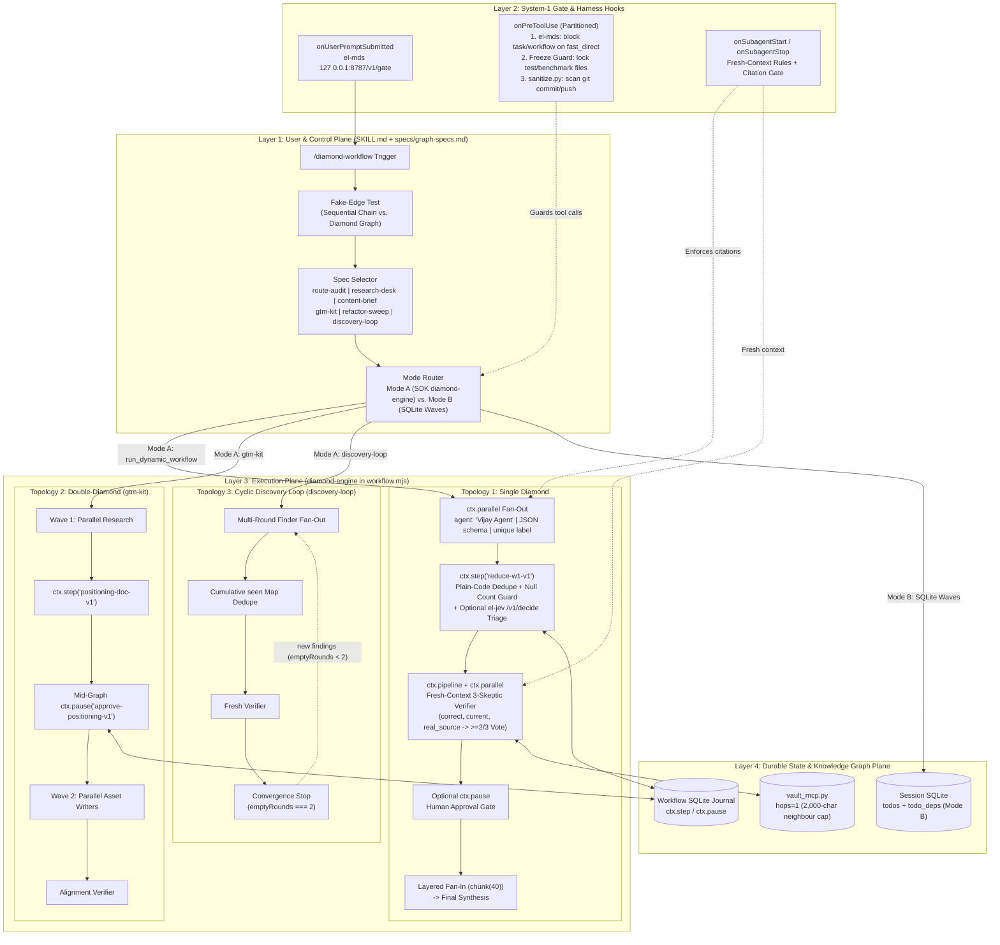
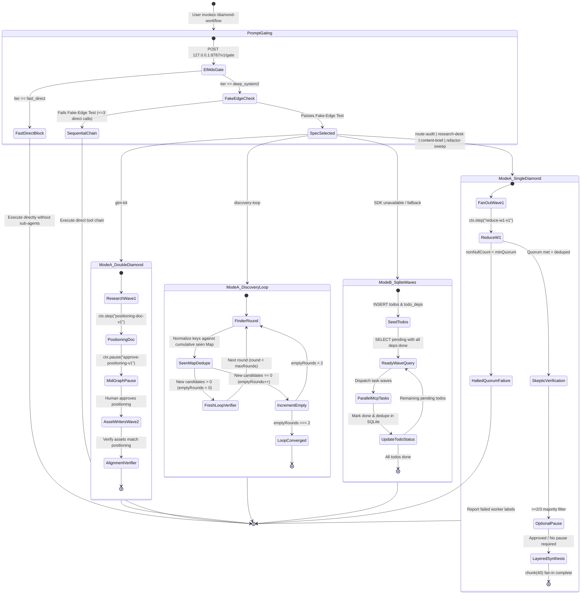

# Graph Engineering Architecture — GitHub Copilot Agent Harness

> **Interactive Diagram:** Open [`docs/architecture.html`](./architecture.html) for the standalone, explorable SVG architecture viewer (Light/Dark themes, Guided Story views, Trace Motion, and PNG/SVG/WebP export).
> **Research Foundation:** See [`docs/research/how-to-imbibe-and-create-agents-or-workflows-based.md`](./research/how-to-imbibe-and-create-agents-or-workflows-based.md) and [`docs/research/how-to-imbibe-and-create-agents-or-workflows-based.html`](./research/how-to-imbibe-and-create-agents-or-workflows-based.html).

---

## 1. Architectural Overview

`copilot-workflow` implements **Graph Engineering for the GitHub Copilot Agent Harness**—replacing ad-hoc, flat sub-agent fan-out with typed **Diamond Workflows** (`Fan-Out -> Plain-Code Reduce -> Fresh-Context Skeptic Verifier -> Layered Synthesis`), gated by a fast **System-1 Router (`el-mds` / `el-jev`)** and deterministic **Harness Hooks**.

The architecture is partitioned into four planes:

1. **Layer 1 — User & Control Plane (`SKILL.md` + `specs/graph-specs.md`):** Handles `/diamond-workflow` invocation, enforces the **Fake-Edge Test** (rejecting graph overhead when a sequential tool chain suffices), selects one of six canonical graph specifications, and routes execution between **Mode A** (Dynamic Workflows SDK `diamond-engine`) and **Mode B** (Session SQLite `todos` + `todo_deps` + MCP `task` waves).
2. **Layer 2 — System-1 Gate & Harness Hooks (`el-mds` + `diamond-workflow` Hooks + `sanitize.py`):** Enforces pre-prompt routing (`127.0.0.1:8787/v1/gate`), partitioned `onPreToolUse` guards (blocking sub-agent delegation on `fast_direct`, locking frozen test/benchmark files on `edit`/`create`/`apply_patch`, and scanning `git commit`/`push` via `sanitize.py`), and `onSubagentStart`/`onSubagentStop` citation gates.
3. **Layer 3 — Execution Plane (`diamond-engine` in `workflow.mjs`):** Executes three verified graph topologies—**Single Diamond**, **Double-Diamond (`gtm-kit`)**, and **Cyclic Discovery Loop (`discovery-loop`)**—with strict JSON schema contracts, plain-JavaScript deduplication, `>=2/3` fresh-context skeptic verification, and `chunk(40)` layered fan-in.
4. **Layer 4 — Durable State & Knowledge Graph Plane:** Persists step checkpoints and human approval tokens in the **SQLite Workflow Journal** (`ctx.step` / `ctx.pause`), tracks Mode B dependency waves in **Session SQLite** (`todos` + `todo_deps`), and bounds knowledge retrieval in **`vault_mcp.py`** (`hops=1` progressive disclosure with a 2,000-character neighbour summary cap).

---

## 2. System Architecture Diagram (Mermaid)



---

## 3. Execution Sequence Diagram (Mermaid)

```mermaid
sequenceDiagram
  autonumber
  actor User
  participant Gate as el-mds / el-jev (:8787)
  participant Control as Control Plane (SKILL.md)
  participant Hooks as Harness Hooks (PreTool / Subagent)
  participant Engine as diamond-engine (workflow.mjs)
  participant Workers as Parallel Workers (Vijay Agent)
  participant Skeptics as 3-Skeptic Verifier (Fresh Context)
  participant State as SQLite Journal & vault_mcp.py

  User->>Gate: Submit prompt (/diamond-workflow <spec>)
  Gate-->>Control: onUserPromptSubmitted (/v1/gate -> deep_system2)
  Control->>Control: Run Fake-Edge Test & select Graph Spec
  Control->>Hooks: Request run_dynamic_workflow / task wave
  Hooks->>Hooks: Verify tier != fast_direct & frozen files untouched
  Hooks-->>Engine: Dispatch Mode A (diamond-engine) or Mode B (SQLite wave)

  rect rgb(20, 45, 65)
    Note over Engine,Workers: Wave 1 — Parallel Map (Fan-Out)
    Engine->>Workers: ctx.parallel({ agent: "Vijay Agent", schema, label })
    Hooks->>Workers: onSubagentStart (inject source & schema rules)
    Workers->>State: vault_read(page, hops=1) [<= 2,000-char neighbour cap]
    Workers-->>Hooks: Return structured JSON claims + citations
    Hooks->>Hooks: onSubagentStop (verify citation & schema completeness)
    Hooks-->>Engine: Validated worker outputs (or null on timeout)
  end

  rect rgb(25, 55, 45)
    Note over Engine,State: Deterministic Reduce & System-1 Triage
    Engine->>State: ctx.step("reduce-w1-v1") — Plain-JS dedupe + null count guard
    Engine->>Gate: Optional /v1/decide for borderline claim triage
    Gate-->>Engine: Triage classification
    State-->>Engine: Checkpointed canonical claim list
  end

  rect rgb(60, 30, 45)
    Note over Engine,Skeptics: Fresh-Context 3-Skeptic Verification
    Engine->>Skeptics: ctx.pipeline + ctx.parallel (claims + URLs only, zero worker prose)
    Skeptics->>State: Verify against primary source / vault_mcp.py
    Skeptics-->>Engine: 3 independent boolean votes (correct, current, real_source)
    Engine->>Engine: Keep claims with >= 2/3 majority pass
  end

  opt Human Gate Enabled (e.g., gtm-kit approve-positioning-v1)
    Engine->>State: Persist checkpoint & emit ctx.pause token
    Engine-->>User: Request approval on verified positioning/claims
    User-->>Engine: Resume run (resumeFromRunId)
  end

  Engine->>Engine: Layered Fan-In (chunk(40)) -> Final Synthesis
  Engine-->>User: Verified deliverable + audit trail
```



---

## 4. Workflow State Machine Diagram (Mermaid)



---

## 5. Layer-by-Layer Technical Walkthrough

### 5.1 Layer 1: User & Control Plane (`SKILL.md` + `specs/graph-specs.md`)

1. **`/diamond-workflow` Trigger & Fake-Edge Test:**
   - Every candidate workflow must pass the **Fake-Edge Test** before spawning sub-agents:
     - *Can the task be completed in $\le 5$ direct tool calls?* $\rightarrow$ Execute directly.
     - *Do workers share mutable state during a wave?* $\rightarrow$ Refactor into independent map shards or run sequentially.
     - *Does the reducer require an LLM just to deduplicate keys?* $\rightarrow$ Replace with plain JavaScript in `ctx.step`.
2. **Spec Selector (`specs/graph-specs.md`):**
   - Selects one of six pre-engineered graph specifications:
     | Spec ID | Topology | Primary Use Case | Fan-Out Shards | Verification Gate |
     |---|---|---|---|---|
     | `route-audit` | Single Diamond | Codebase route/endpoint/security audit | Directory / module shards | 3-Skeptic file:line proof |
     | `research-desk` | Single Diamond | Multi-source technical/market research | Domain / source shards | 3-Skeptic citation + date check |
     | `content-brief` | Single Diamond | Executive briefing & architecture synthesis | Topic / section shards | 3-Skeptic claim verification |
     | `gtm-kit` | Double-Diamond | Positioning + multi-asset GTM generation | Wave 1 research $\rightarrow$ Wave 2 assets | `approve-positioning-v1` + Alignment Verifier |
     | `refactor-sweep` | Single Diamond | Cross-repo code migration / contract sweep | File-group shards | Freeze guard + test runner verification |
     | `discovery-loop` | Cyclic Loop | Exhaustive entity/vulnerability discovery | Multi-round search shards | Cumulative `seen` Map + `emptyRounds === 2` |
3. **Mode Router (Mode A vs. Mode B):**
   - **Mode A (Primary):** Invokes `run_dynamic_workflow` targeting the registered `diamond-engine` workflow in `workflow.mjs`.
   - **Mode B (Fallback):** Uses session SQLite (`todos` and `todo_deps`) to model the exact same DAG waves and dispatches parallel `task` calls per ready wave.

---

### 5.2 Layer 2: System-1 Gate & Harness Hooks (`el-mds` + `diamond-workflow` Hooks + `sanitize.py`)

Hook execution is strictly partitioned so fast deterministic checks run in milliseconds before any model or tool invocation:

| Lifecycle Hook | Component | Responsibility & Enforcement Contract |
|---|---|---|
| `onUserPromptSubmitted` | `el-mds` (`127.0.0.1:8787/v1/gate`) | Classifies prompt intent and complexity (`fast_direct` vs. `deep_system2`) and injects the execution contract into the turn context. |
| `onPreToolUse` (Gate 1) | `el-mds` Delegation Guard | Blocks `task` and `run_dynamic_workflow` calls when the turn tier is `fast_direct`, preventing unnecessary sub-agent fan-out on simple tasks. |
| `onPreToolUse` (Gate 2) | `diamond-workflow` Freeze Guard | Locks frozen test suites, evaluation harnesses, and benchmark files during `edit`, `create`, and `apply_patch` so worker agents cannot game verification metrics. |
| `onPreToolUse` (Gate 3) | `sanitize.py` Secret & Policy Scanner | Intercepts `git commit` and `git push` commands to scan staged diffs for credentials, tokens, internal GUIDs, or policy violations. |
| `onSubagentStart` | `diamond-workflow` Context Injector | Injects strict JSON output requirements, primary-source citation rules, and fresh-context isolation constraints into every spawned sub-agent. |
| `onSubagentStop` | `diamond-workflow` Citation Gate | Validates that worker and verifier outputs contain non-empty `source_url` / `file_path:line` evidence and conform to the node's JSON schema before returning to the parent graph. |

---

### 5.3 Layer 3: Execution Plane (`diamond-engine` in `workflow.mjs`)

All workflow helper functions, schemas, and constants are defined **inside** the `run` function body so the Dynamic Workflows runtime serializes a self-contained closure.

#### Node Contracts & Schemas

1. **Parallel Map Node (`ctx.parallel`):**
   - Always specifies `agent: "Vijay Agent"`, a strict JSON `schema`, and a unique deterministic `label` per shard (e.g., `map-w1-shard-01`).
   - Output contract per shard:
     ```json
     {
       "shard_id": "shard-01",
       "claims": [
         {
           "id": "claim-hash",
           "statement": "Concrete falsifiable finding",
           "source": "path/to/file.ts:42 or https://...",
           "observed_at": "2026-10-19",
           "confidence": "high"
         }
       ]
     }
     ```
2. **Plain-Code Reduce Node (`ctx.step("reduce-w1-v1")`):**
   - **Never uses an LLM to deduplicate.** Runs deterministic JavaScript inside `ctx.step("reduce-w1-v1", async () => { ... })`.
   - **Fan-In Count Guard (`null` check):** Checks `results.filter(r => r !== null)`. If a worker timed out or returned `null`, logs the exact missing `label` and fails closed if `validResults.length < minQuorum`.
   - **Optional System-1 Triage (`el-jev` `/v1/decide`):** For borderline or ambiguous items, calls the local `el-jev` daemon (`127.0.0.1:8787/v1/decide`) for sub-10ms classification rather than spawning a LLM judge.
3. **Fresh-Context 3-Skeptic Verifier (`ctx.pipeline` + `ctx.parallel`):**
   - **Anti-Context-Rot Rule:** Receives **only** the deduplicated `{ id, statement, source, observed_at }` claims—never the worker's chain-of-thought or persuasive prose.
   - Spawns 3 independent skeptic verifiers in parallel (`skeptic-correct`, `skeptic-current`, `skeptic-real-source`), each returning `{ claim_id, correct: boolean, current: boolean, real_source: boolean, reason }`.
   - A claim survives only if **$\ge 2/3$ skeptics** vote `true` across all three predicates.
4. **Optional Human Gate (`ctx.pause`) & Layered Fan-In (`chunk(40)`):**
   - When human sign-off is required, `ctx.pause("<gate-id>-v1", payload)` checkpoints state to SQLite and halts consumption until resumed via `resumeFromRunId`.
   - If verified items exceed 40, synthesis uses **Layered Fan-In (`chunk(40)`)**: reducing batches of 40 into intermediate summaries before final synthesis so no single prompt suffers middle-of-context degradation.

#### Topology Specifics

- **Topology 1 — Single Diamond:** `Fan-Out -> ctx.step("reduce-w1-v1") -> 3-Skeptic Verifier -> Optional ctx.pause -> chunk(40) Synthesis`.
- **Topology 2 — Double-Diamond (`gtm-kit`):**
  1. **Diamond 1 (Discovery & Positioning):** Wave 1 parallel market/account research $\rightarrow$ plain-code reduce $\rightarrow$ `ctx.step("positioning-doc-v1")` $\rightarrow$ mid-graph `ctx.pause("approve-positioning-v1")`.
  2. **Diamond 2 (Asset Production & Alignment):** Once positioning is approved, Wave 2 spawns parallel asset writers (pitch deck outline, one-pager, competitive battlecard, follow-up email) $\rightarrow$ **Alignment Verifier** checks every asset against the frozen `positioning-doc-v1`.
- **Topology 3 — Cyclic Discovery Loop (`discovery-loop`):**
  - Maintains a cumulative JavaScript `Map` (`seen`) keyed by canonical entity/finding ID across rounds.
  - Each round runs `Finder Fan-Out -> Seen Map Dedupe -> Fresh Verifier`.
  - Tracks `emptyRounds`: if a round yields `0` newly verified items not already in `seen`, `emptyRounds` increments (`emptyRounds++`); otherwise `emptyRounds = 0`.
  - Terminates deterministically when `emptyRounds === 2` or `round === maxRounds`.

---

### 5.4 Layer 4: Durable State & Knowledge Graph Plane

1. **Workflow SQLite Journal (`ctx.step` / `ctx.pause`):**
   - Every `ctx.step(id, fn)` and `ctx.pause(id, payload)` is journaled by its versioned step ID (`*-v1`). Resuming a paused or interrupted workflow replays completed step outputs from SQLite at zero token cost.
2. **Session SQLite (`todos` + `todo_deps`):**
   - Powers **Mode B** execution when running outside the Dynamic Workflows SDK:
     ```sql
     SELECT t.* FROM todos t
     WHERE t.status = 'pending'
       AND NOT EXISTS (
         SELECT 1 FROM todo_deps td
         JOIN todos dep ON td.depends_on = dep.id
         WHERE td.todo_id = t.id AND dep.status != 'done'
       );
     ```
3. **Vault MCP Progressive Disclosure (`vault_mcp.py`):**
   - `vault_read(page, hops=1)` returns the target page plus a `## Linked pages` block of 1-hop neighbour titles and one-line summaries—never their full bodies—hard-capped at **2,000 characters** (inline links prioritized ahead of auto-generated `## Related` links).

---

## 6. Failure-Mode Mitigations

| # | Failure Mode | Root Cause in Naive Agent Loops | Architectural Mitigation in `copilot-workflow` |
|---|---|---|---|
| 1 | **Fake-Edge Bloat** | Spawning multi-agent graphs for 3-step linear lookups | **Fake-Edge Test** in `SKILL.md` + `el-mds` `fast_direct` pre-tool block |
| 2 | **Silent Worker Dropout** | `ctx.parallel` returns `null` for a timed-out branch, crashing reducer or silently dropping coverage | **Fan-In Count Guard** inside `ctx.step("reduce-w1-v1")` checks `null` entries by `label` and enforces `minQuorum` |
| 3 | **Echo-Chamber Verification** | Passing worker reasoning/prose into the reviewer causes sycophantic agreement | **Fresh-Context 3-Skeptic Verifier** receives only `{ statement, source, observed_at }` and requires $\ge 2/3$ vote |
| 4 | **Context Window Overflow at Fan-In** | Dumping 100+ worker outputs into one synthesis prompt degrades recall | **Layered Fan-In (`chunk(40)`)** reduces in batches of $\le 40$ items |
| 5 | **LLM Deduplication Drift** | Using an LLM to merge lists drops valid items or invents hybrids | **Plain-Code Reduce** in `ctx.step` performs deterministic hash/key deduplication in JavaScript |
| 6 | **Benchmark / Test Tampering** | Coding sub-agent edits test assertions to make a failing build pass | **Freeze Guard** in `onPreToolUse` blocks `edit`/`create`/`apply_patch` on frozen test/benchmark paths |
| 7 | **Unapproved Strategic Drift** | Generating downstream GTM assets from an unreviewed positioning hypothesis | **Mid-Graph `ctx.pause("approve-positioning-v1")`** in `gtm-kit` freezes execution until human sign-off |
| 8 | **Infinite / Premature Discovery Loops** | Stopping after one dry shard or looping forever on duplicate hits | **Cumulative `seen` Map + `emptyRounds === 2`** convergence criterion in `discovery-loop` |
| 9 | **Knowledge Graph Context Explosion** | Recursively pulling full linked wiki pages into prompt context | **`vault_mcp.py` `hops=1` cap** limits 1-hop neighbour summaries to 2,000 chars total |
| 10 | **Secret / PII Leakage in Commits** | Autonomous commit includes credentials, local paths, or restricted strings | **`sanitize.py`** hook on `onPreToolUse` scans `git commit` / `git push` payloads before execution |
