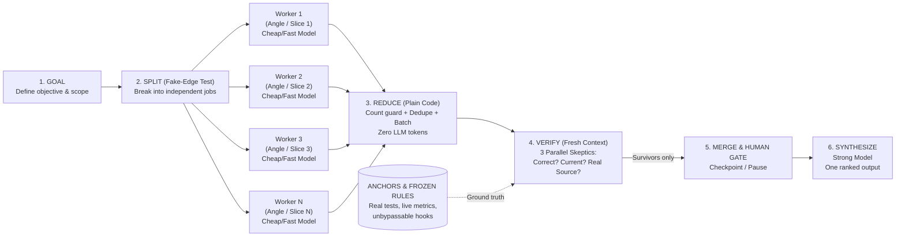

# Imbibing and Creating Agents & Workflows with Graph Engineering in the GitHub Copilot Agent Harness

## Executive Summary

Anatoli Kopadze's July 24, 2026 X Article, *"Graph Engineering explained: what it is, when to use it and when not to"* (`status/2080668775796314331`, article ID `2080620345854140416`), formalizes the shift in AI engineering from single-agent loops to **graphs of loops**—explicitly wired networks where bounded worker nodes execute in parallel, plain code reduces outputs without burning tokens, isolated fresh-context verifier nodes challenge every claim against external ground-truth **anchors**, and a final synthesizer produces decision-grade output[^1][^2].

Although Kopadze's `§10–§11` uses Claude Code's `"workflow"` keyword as his example, **dynamic workflows are NOT a Claude Code-only feature**[^1][^5][^6]. **GitHub Copilot CLI (`v1.0.99-0` / `@github/copilot-sdk`) natively implements this exact programmatic workflow architecture**—and extends it with SQLite-journaled steps (`ctx.step`), resumable human checkpoints (`ctx.pause`), enforced JSON schemas with automatic 1× retry (`ctx.agent({ schema })`), barrier-free streaming pipelines (`ctx.pipeline`), and hard/soft resource ceilings (`maxConcurrentSubagents`, `maxTotalSubagents`, `maxAiCredits`, `timeoutSeconds`)[^5][^6][^18]. You can author and execute these graphs in GitHub Copilot CLI via three native paths:
1. **On-the-Fly Session Dynamic Workflows:** Prompt Copilot CLI to call `dynamic_workflows_manage({ operation: "author", meta, run })` followed by `run_dynamic_workflow({ name, args })`[^6].
2. **Saved Reusable Extension Workflows:** Save `.github/extensions/<name>/extension.mjs` (or `~/.copilot/extensions/<name>/extension.mjs`) using `defineWorkflow` + `joinSession({ workflows })`[^5][^6][^18].
3. **Zero-JS Conversational Fleet Waves:** Run `/fleet` with `@vijay-agent` backed by session SQLite `todos` + `todo_deps` and parallel `task` calls[^22].

---

## 1. Deconstructing Anatoli Kopadze's Graph Engineering Architecture

Published on July 24, 2026 as a 13-section X Article with 6 diagrams and 10 specification/code blocks, Kopadze's framework builds directly on his earlier June 20, 2026 *"Loops explained"* article (`DISCOVER → PLAN → EXECUTE → VERIFY → ITERATE`) and Peter Steinberger's prompt (*"Are we still talking loops or did we shift to graphs yet?"*)[^1][^2][^10].



### 1.1 Core Primitives: Node Contracts, Real Edges, and the Fake-Edge Test

1. **The Node Contract (`§2`, lines 56–83):** A node is *"one job: one agent doing one task, with one thing going in and one thing coming out."* If a node outputs free text, only a human can read it; enforcing a strict output schema makes the node **wire-able**[^1]:

```text
▸ NODE CONTRACT (zeuikli/cc-workspace-docs:.../2026-07-24-AnatoliKopadze-314331.md:75-83)
JOB:     research one competitor's pricing
IN:      { competitor: "name", url: "https://..." }   ← passed in, never assumed
OUT:     { price: number, plan: string, source: url, date: "YYYY-MM-DD" }
SCHEMA:  enforced; free-text return → rejected and retried
WHY:     defined output = next node reads it without a human → "wire-able"
```

2. **The Fake-Edge Test (`§3–§4`, lines 87–109):** An edge is valid **only** when a downstream job requires data produced by an upstream job. At every sequential boundary (`A → B`), ask: *"Does step B actually need the result of step A?"* If no data crosses the arrow, cut the edge and run them concurrently[^1].

### 1.2 The Signature Topology: The Diamond (`§5`, lines 113–170)

The foundational pattern that pays for its token overhead is **The Diamond** (`Fan Out → Reduce → Verify → Synthesize`)[^1]:

```javascript
// Block 2 (zeuikli/cc-workspace-docs:.../2026-07-24-AnatoliKopadze-314331.md:131-166)
const angles = [
  "pricing vs top 3 competitors",
  "buyer review complaints",
  "category feature gaps",
  "market moves next 12 months",
];

// 1. FAN OUT — independent angles run concurrently on cost-efficient models
const raw = await parallel(
  angles.map(a => () => agent({
    task: `research: ${a}. every claim needs a source url + date.`,
    schema: Finding,        // machine-validated output, never free text
    model: "cheap",         // bounded extraction node → fast/cheap model
  }))
);

// 2. REDUCE — deterministic plain code, zero model calls, zero tokens
const findings = dedupeBySource(raw.flat().filter(Boolean));

// 3. VERIFY — isolated fresh-context skeptic per finding on a strong model
const survivors = await parallel(
  findings.map(f => () => agent({
    task: "try to disprove this. return keep | drop + why.",
    input: f,
    freshContext: true,     // NEVER reuse the worker's conversation history
    model: "strong",        // judgment node → frontier reasoning model
  }))
).then(v => findings.filter((_, i) => v[i].verdict === "keep"));

// 4. SYNTHESIZE — single high-judgment call over verified survivors
return agent({
  task: "one report, ranked by confidence, sources attached.",
  input: survivors,
  model: "strong",
});
```

### 1.3 The Fresh-Context 3-Skeptic Verifier Node (`§6`, lines 174–208)

Kopadze's central verification rule is: ***"You never let the agent that did the work check the work... A worker and its verifier must never share a context."***[^1]

```text
▸ VERIFIER NODE (zeuikli/cc-workspace-docs:.../2026-07-24-AnatoliKopadze-314331.md:194-204)
INPUT:    one finding only (never the worker's chat)
CONTEXT:  fresh and empty
CHECKS:   three skeptics in parallel, each a different question
  1. is it correct?      → claim holds up logically/technically
  2. is it current?      → source recent, not stale
  3. is the source real? → link/file resolves to the cited claim
PASS:     keep only if a majority (≥2 of 3) of skeptics let it live
FAIL:     drop before it reaches the final answer
```

### 1.4 The Three Graph Failure Modes & Code Remedies (`§7`, lines 212–263)

| Failure Mode | Root Cause | Architectural Fix | Kopadze Reference Pattern |
|---|---|---|---|
| **1. Context Collapse** (`§7.1`, lines 216–228) | Pouring 100–1,000 raw worker outputs into a single synthesizer overflows or degrades attention. | **Layered Fan-In:** Chunk worker outputs into batches (e.g., 40 items), summarize each batch in parallel, then synthesize over ~25 summaries. | `const batches = chunk(results, 40);`<br>`const summaries = await parallel(batches.map(...));`[^1] |
| **2. False Independence (Hidden Edges)** (`§7.2`, lines 232–247) | Parallel workers mutate a shared filesystem, git index, or rate-limited API and overwrite each other. | **Worktree Isolation:** Give every file-mutating worker its own `git worktree` (or serialize shared-file writes with an explicit edge). | `agent({ task: "refactor ${f}", worktree: true })`<br>*Rule: two nodes writing the same file need an edge, not parallelism.*[^1] |
| **3. Silent Node Failure** (`§7.3`, lines 251–263) | One dead/timed-out node among 50 drops out quietly; the synthesizer writes a "complete" report over partial data. | **Fan-In Count Guard:** Assert `results.length === jobs.length` in code before synthesis; flag or halt on any `null` return. | `if (results.length < jobs.length) flag("WARNING: ${jobs.length - results.length} missing");`[^1] |

---

## 2. Is It a Claude Code Feature Only, or Does It Work in GitHub Copilot CLI?

**It is NOT a Claude Code-only feature.** While Kopadze's `§10` illustrates dynamic workflows in Claude Code (triggered by starting a prompt with the word `"workflow"`), **GitHub Copilot CLI (`v1.0.99-0`) ships a first-class, production-grade Dynamic Workflow engine (`@github/copilot-sdk/extension`)** alongside `/fleet` and `.agent.md` subagent waves[^5][^6][^18].

| Capability | Claude Code (§10 of Kopadze Article)[^1] | GitHub Copilot CLI (`v1.0.99-0` — Your Harness)[^5][^6][^18] |
|---|---|---|
| **Ad-Hoc Session Workflow (Write & Run JS Orchestration on the Fly)** | Triggered by starting the prompt with `"workflow"` or `"Run as a dynamic workflow"`. Claude writes an orchestration script and spawns sub-agents. | **Native Tool Pair:** Copilot calls `dynamic_workflows_manage({ operation: "author", meta, run })` to register a self-contained JS `run(ctx)` function in session memory, then calls `run_dynamic_workflow({ name, args })`. |
| **Saved Reusable Workflow ("Launch by Name")** | Save a good run as a reusable slash command. | **Persistent Extension:** Save `.github/extensions/<name>/extension.mjs` (project) or `~/.copilot/extensions/<name>/extension.mjs` (user) calling `defineWorkflow({ meta, run })` + `joinSession({ workflows })`. Launch via `run_dynamic_workflow`, `/workflows`, or `copilot --experimental workflow run <name>`. |
| **Zero-JS Fleet Waves (Works with Main-Session MCPs)** | Prompt subagents in parallel batches. | **`/fleet` + `@vijay-agent`:** Orchestrator records the DAG in session SQLite (`todos` + `todo_deps`) and dispatches ready waves via parallel `task(mode="sync")` calls[^22]. |
| **Enforced Node JSON Schemas** | `agent({ task, schema: Finding })` | `ctx.agent(prompt, { label, schema })` — validates JSON against `WorkflowJsonSchema` and **automatically retries once** on mismatch[^5][^6]. |
| **Parallel Fan-Out & Streaming DAGs** | `parallel(jobs)` barrier. | **Both:** `ctx.parallel(thunks)` (barrier up to 4,096 items) **and** `ctx.pipeline(items, ...stages)` (barrier-free per-item multi-stage DAG)[^5][^6]. |
| **Silent Failure Detection** | Check `results.length < jobs.length`. | Built-in contract: ordinary `ctx.agent` failures resolve to `null` (never silently dropped from the array), making `raw.filter(r => r === null)` deterministic[^6][^18]. |
| **Durable Checkpointing & Human Gates** | Prompt-level pause. | **SQLite-Journaled:** `ctx.step("key-v1", fn)` caches deterministic reductions; `ctx.pause("gate-v1")` checkpoints the run to SQLite and resumes from the exact pause point via `/workflows` or `run_dynamic_workflow({ resumeFromRunId })` without re-running completed agents[^6][^18][^19]. |
| **Resource & Cost Caps** | Prompt instruction (`CAP: 20 files`). | **Runtime Enforced:** `limits: { maxConcurrentSubagents, maxTotalSubagents, timeoutSeconds, maxAiCredits }`. On `workflow_limit_reached`, resume the same `runId` raising only the exhausted limit[^5][^6]. |

---

## 3. Exact Copy-Paste Prompts to Create & Run Graph Workflows

### 3.1 Kopadze's Original Base Prompt vs. GitHub Copilot CLI Master Prompts

In Kopadze's Image 5 (`pbs.twimg.com/media/HN_0W-CXIAAndeR.jpg`, placed at `§10` line 360), the exact copy-paste prompt for Claude Code is[^1]:

```text
Run as a dynamic workflow.
Break the job into the right number of parallel sub-agents.
Spawn them.
They work independently.
You collect, verify, and merge everything
into a single final answer.
```

Because GitHub Copilot CLI's `dynamic_workflows_manage` and `run_dynamic_workflow` tools require an explicit user instruction to author/run a workflow (and require calling `operation: "guide"` before `operation: "author"`), use one of these **three GitHub Copilot CLI master prompts** depending on your goal:

#### Prompt A: Author & Run an Ad-Hoc Dynamic Workflow in the Current Session (Direct Equivalent to Claude Code's `"workflow"` Trigger)
```text
Author and run a dynamic workflow for this task using `dynamic_workflows_manage` (call `operation: "guide"` first, then `operation: "author"`) and `run_dynamic_workflow`:
1. FAN OUT: Use `ctx.parallel` to spawn `ctx.agent` workers with unique `label`s (`worker:${i}`) and an enforced JSON `schema`.
2. REDUCE: In a durable `ctx.step("reduce-v1", ...)`, enforce a fan-in count guard (check for `null` results) and deduplicate findings in plain JS (0 tokens).
3. VERIFY: Use `ctx.pipeline` to verify each surviving claim in a fresh context (`agent: "rubber-duck"`, schema verdict `keep|drop`).
4. SYNTHESIZE: Merge only verified survivors into the final JSON output.
```

#### Prompt B: Scaffold a Saved, Reusable Workflow Extension ("Save It and Launch by Name")
```text
Create a reusable GitHub Copilot CLI workflow extension in `.github/extensions/<workflow-name>/extension.mjs` (with the workflow logic in `workflow.mjs` and an offline unit test in `workflow.test.mjs`) using `defineWorkflow` and `joinSession({ workflows })` from `@github/copilot-sdk/extension`.
Implement Kopadze's Diamond Pattern:
- `ctx.parallel` worker fan-out with unique `label`s and JSON `schema`
- `ctx.step("reduce-v1")` plain-code deduplication and `null` fan-in count guard
- Fresh-context 3-skeptic verifier stage (`ctx.pipeline`)
- Optional `ctx.pause("approval-v1")` human gate before final synthesis
Verify with `node --test` against a mock `ctx`, then reload extensions.
```

#### Prompt C: Run as a Zero-JS `/fleet` Wave Graph (Best When Workers Need Main-Session MCPs like `crm`, `mailbox`, or `vault`)
```text
/fleet Execute this as a Kopadze Diamond Graph using `@vijay-agent`:
1. Fake-Edge Test: register all independent worker slices, a reduce step, a fresh-context verifier step, and final synthesis in the session SQLite `todos` and `todo_deps` tables.
2. Wave 1 (Fan-Out): dispatch all ready worker todos in parallel `task` calls (`mode: "sync"`). Each worker must return a JSON block with `claim`, `source`, `date`, and `verdict`.
3. Wave 2 (Count Guard & Reduce): query SQLite `todos` to verify 0 missing nodes, then deduplicate claims.
4. Wave 3 (Fresh Verifier): dispatch `rubber-duck` or `triage-team:skeptic` with ONLY the reduced claims (never the worker transcripts) before synthesizing.
```

---

### 3.2 Architectural Decision: Should You Build a `diamond-workflow` Skill, a `Vijay-Diamond` Agent, or Keep 6 Prompts?

You do **not** need 6 separate copy-paste prompts, and you should **not** create a separate `Vijay-Diamond` custom agent. All 6 of Kopadze's `▸ GRAPH SPEC` blocks are parameterizations over just **three graph topologies** (`diamond`, `double-diamond` with a mid-flow gate, and `cyclic-discovery-loop`).

Evaluating the three ways to package this against your existing workspace architecture (`vijay-agent.agent.md`, `demo-stack/SKILL.md` → `demo-orchestrator.agent.md` → `stacks/stacks.md`, and the `el-mds` hook extension) yields a clear winner[^6][^18][^20][^22][^23]:

| Packaging Option | Copilot CLI Tool-Gate Compliance | Context & Maintenance Cost | Interaction with Your Agents & `el-mds` Hook | Verdict |
|---|---|---|---|---|
| **Option A: New `Vijay-Diamond` Agent (`.agent.md`)** | **Weak:** The `run_dynamic_workflow` and `dynamic_workflows_manage` tool schemas explicitly state: *"Use only when the user explicitly requests a workflow, or when a **skill or slash command** specifically instructs you to use one."* Standing `.agent.md` instructions do not satisfy the skill/slash-command gate. | Duplicates `vijay-agent.agent.md` and `vijay-caveman.agent.md`; requires duplicate model entries in `~/.copilot/settings.json`. | Creates persona sprawl. Workflow nodes inside `.mjs` can already run as `ctx.agent(..., { agent: "Vijay Agent" })`[^5]. | **❌ Skip** |
| **Option B: Embed All 6 Specs Inside `vijay-agent.agent.md`** | **Weak:** Still lacks an explicit skill or slash-command trigger to authorize `run_dynamic_workflow`. | Loads ~200 lines of spec templates into **every single turn** (even trivial questions), violating progressive disclosure[^13]. | Violates `demo-orchestrator.agent.md:189` (*edit the routing table, not the agent file*)[^23]. | **❌ Skip** |
| **Option C: Thin `diamond-workflow` Skill (`SKILL.md`) + `specs/graph-specs.md` Table + Parameterized `.mjs` Engine** | **100% Native:** Invoking `/diamond-workflow` (or matching its `SKILL.md` trigger) satisfies the exact *"when a skill or slash command instructs you to"* contract on `run_dynamic_workflow`[^6][^18]. | **Zero idle tokens:** The skill and spec table load only when triggered. Coalesces all 6 prompts into one declarative table. | `el-mds` (`extension.mjs:8`) gates `task` and `run_dynamic_workflow` identically in `DENIED_FAST_DIRECT_TOOLS` (blocking both on `fast_direct` turns, allowing both on `deep_system2` turns)[^20]. Add 1 routing line to `vijay-agent.agent.md:45`. | **✅ Build This** |

#### How the Coalesced Skill + Spec Table + Engine Works Together

1. **Thin Skill Trigger (`~/.copilot/skills/diamond-workflow/SKILL.md`):** Mirrors `demo-stack/SKILL.md:12-25` and `xavierxmorris/copilot-dynamic-workflows-guide:README.md:3` (*"Use a skill to guide judgment. Use a dynamic workflow to encode a repeatable process"*)[^18][^23]:
   ```markdown
   ---
   name: diamond-workflow
   description: >-
     Run Kopadze Graph Engineering workflows (Diamond research desk, route/security
     audit, content brief, double-diamond GTM kit, refactor sweep, or discovery
     loop) via Copilot Dynamic Workflows or /fleet waves.
   user-invocable: true
   ---
   # Diamond Workflow Router
   1. Read `specs/graph-specs.md` to map the user's request to one of the 6 spec IDs:
      `route-audit` | `research-desk` | `content-brief` | `gtm-kit` | `refactor-sweep` | `discovery-loop`.
   2. If worker nodes require main-session MCP tools (`crm`, `mailbox`, `analytics`, `vault`), execute Mode B:
      insert the spec's stages into session SQLite `todos` + `todo_deps` and dispatch parallel `task` waves.
   3. Otherwise, execute Mode A: call `run_dynamic_workflow({ name: "diamond-research", args: { specId, question, angles, pauseBeforeSynthesis } })` (or author it via `dynamic_workflows_manage` if not registered).
   ```

2. **Coalesced Spec Table (`~/.copilot/skills/diamond-workflow/specs/graph-specs.md`):** Replaces all 6 copy-paste prompts with one data table:
   ```markdown
   | Spec ID | Topology | Fan-Out Unit | Verifier Lens (`ctx.pipeline`) | Default Cap | Human Gate (`ctx.pause`) |
   |---|---|---|---|---|---|
   | `route-audit` | `diamond` | 1 agent per file (`src/routes/*`) | `code-review` (missing auth check) | 20 files | Flag `null` files; gate report |
   | `research-desk` | `diamond` | 5 orthogonal angles | 3-skeptic (`correct`, `current`, `real_source`) | 5 angles | `pre-synthesis-approval-v1` |
   | `content-brief` | `diamond` | 3 jobs (coverage, real Qs, gaps) | Fact-checker flags unsourced claims | 3 jobs | Never auto-publish |
   | `gtm-kit` | `double-diamond` | Wave 1: 3 research → Doc → Wave 2: 3 writers | Asset vs positioning doc check | 6 jobs | **Mid-gate** `approve-positioning-v1` |
   | `refactor-sweep` | `diamond` | 1 agent per file (>100-line fn) | Fresh critic + isolated git worktree | 50 files | Count guard `returned / total` |
   | `discovery-loop` | `cyclic-loop` | Parallel finders per round | Stop after 2 rounds with 0 new verified | 24 agents | Final severity-ranked gate |
   ```

3. **One-Line Pointer in `vijay-agent.agent.md` (line 45):** Keep `vijay-agent` as your single analytical persona, and pass `agent: "Vijay Agent"` inside `ctx.agent(...)` when you want workflow workers to inherit Vijay's perspective[^5][^22].

---

### 3.3 Reference: All 6 Kopadze `▸ GRAPH SPEC` Templates (`§10–§11`) — Verbatim & Adapted for Ad-Hoc Use

#### Template 1: Route Auth Audit (`§10`, lines 333–344)[^1]

**Kopadze Verbatim Spec:**
```text
▸ GRAPH SPEC
GOAL: audit every route file under src/routes/ for missing auth checks

FAN OUT:    one agent per file, all running in parallel
VERIFY:     an independent checker on each finding, with fresh context
CAP:        20 files on this first run
ON FAIL:    flag any file that doesn't return, never skip it silently
REPORT:     one merged list of the routes missing auth

(start the prompt with the word "workflow" so Claude builds the graph)
```

**GitHub Copilot CLI Adapted Prompt:**
```text
Author and run a dynamic workflow (`dynamic_workflows_manage` guide -> author -> `run_dynamic_workflow`):
▸ GRAPH SPEC
GOAL: audit every route file under src/routes/ for missing auth checks
FAN OUT: `ctx.parallel` — one `ctx.agent` per file (unique label `route:${i}`, JSON schema `{file, missingAuthRoutes[]}`)
VERIFY: `ctx.pipeline` — independent `code-review` checker on each finding in a fresh context
CAP: 20 files on this first run (`limits: { maxTotalSubagents: 45 }`)
ON FAIL: in `ctx.step("guard-v1")`, flag any file where `result === null`; never skip it silently
REPORT: one merged list of the routes missing auth
```

#### Template 2: Decision-Grade Research Desk (`§11`, lines 373–385)[^1]

**Kopadze Verbatim Spec:**
```text
▸ GRAPH SPEC
GOAL: decision-grade research on [your question]

FAN OUT:      split into 5 distinct angles, one researcher per angle, in parallel
RULE:         every finding needs a source link and a date
VERIFY:       a skeptic attacks each finding and tries to disprove it, drop what fails
MERGE:        survivors into one report ranked by confidence
SAVE:         research-report.md, then show me the top findings
HUMAN GATE:   change nothing after that without asking me

(start the prompt with the word "workflow" so Claude builds the graph)
```

**GitHub Copilot CLI Adapted Prompt:**
```text
Author and run a dynamic workflow (`dynamic_workflows_manage` guide -> author -> `run_dynamic_workflow`):
▸ GRAPH SPEC
GOAL: decision-grade research on [your question]
FAN OUT: `ctx.parallel` across 5 distinct angles, one `research` subagent per angle (`label: "angle:${i}"`)
RULE: enforce JSON `schema` requiring `claim`, `sourceUrl`, `date`, and `quote`
REDUCE: deduplicate by source in `ctx.step("reduce-v1")` and assert the fan-in count guard
VERIFY: `ctx.pipeline` with a fresh-context `rubber-duck` skeptic attacking each finding (`verdict: "keep"|"drop"`); drop what fails
MERGE: synthesize survivors into one report ranked by confidence and save to `research-report.md`
HUMAN GATE: call `ctx.pause("post-report-gate-v1")` before taking any follow-up action
```

#### Template 3: SEO / Technical Content Machine (`§11`, lines 391–405)[^1]

**Kopadze Verbatim Spec:**
```text
▸ GRAPH SPEC
GOAL: one ranking-ready draft for [topic]

PARALLEL JOBS (run at once):
  1. what the current top-ranking pages cover
  2. the real questions people ask about this topic
  3. what those top pages skip
MERGE:        the three into an outline, then write a full draft
VERIFY:       a fact-checker that flags every claim without a source
SAVE:         drafts/ with the flagged claims listed at the top
HUMAN GATE:   never publish anything

(start the prompt with the word "workflow" so Claude builds the graph)
```

**GitHub Copilot CLI Adapted Prompt:**
```text
Author and run a dynamic workflow (`dynamic_workflows_manage` guide -> author -> `run_dynamic_workflow`):
▸ GRAPH SPEC
GOAL: one ranking-ready draft for [topic]
PARALLEL JOBS (`ctx.parallel`, run at once with JSON schemas):
  1. what the current top-ranking pages cover (`label: "research:coverage"`)
  2. the real questions people ask about this topic (`label: "research:questions"`)
  3. what those top pages skip (`label: "research:gaps"`)
MERGE: combine all three into an outline, then write a full draft
VERIFY: fresh-context fact-checker (`agent: "rubber-duck"`) that flags every claim without a verified source
SAVE: `drafts/` with the flagged claims listed at the top
HUMAN GATE: never publish anything
```

#### Template 4: Go-To-Market / Launch Kit (`§11`, lines 411–429)[^1]

**Kopadze Verbatim Spec:**
```text
▸ GRAPH SPEC
GOAL: full launch kit for [product], aimed at [audience]

PARALLEL JOBS (research, run at once):
  1. profile the buyer and the exact words they use
  2. map where these buyers spend time online
  3. collect how competitors pitch them
MERGE:        a one-page positioning doc
HUMAN GATE:   pause and show me the positioning doc before writing
PARALLEL JOBS (writing, from that doc):
  1. landing page copy
  2. a week of launch posts
  3. a set of outreach messages
VERIFY:       a checker compares every asset to the positioning doc, flags anything off
SAVE:         launch-kit/, change nothing after that without asking me

(start the prompt with the word "workflow" so Claude builds the graph)
```

**GitHub Copilot CLI Adapted Prompt:**
```text
Author and run a dynamic workflow (`dynamic_workflows_manage` guide -> author -> `run_dynamic_workflow`):
▸ GRAPH SPEC
GOAL: full launch kit for [product], aimed at [audience]
PARALLEL JOBS 1 (`ctx.parallel` research):
  1. profile the buyer and exact words they use  2. map where buyers spend time online  3. collect competitor pitches
MERGE: synthesize a one-page positioning doc inside `ctx.step("positioning-doc-v1")`
HUMAN GATE: call `await ctx.pause("approve-positioning-v1")` so I can inspect the positioning doc and resume the run ID before writing
PARALLEL JOBS 2 (`ctx.parallel` writing from the journaled positioning doc):
  1. landing page copy  2. a week of launch posts  3. outreach messages
VERIFY: fresh-context checker compares each asset to the positioning doc and flags drift
SAVE: `launch-kit/`
```

#### Template 5: Refactor Sweep (`§11`, lines 435–446)[^1]

**Kopadze Verbatim Spec:**
```text
▸ GRAPH SPEC
GOAL: find every function over 100 lines and propose a refactor for each

FAN OUT:    one agent per file, in parallel
VERIFY:     an independent checker on each proposed refactor, fresh context
DEDUPE:     proposals against everything already seen
CAP:        50 files on this first run
REPORT:     how many files came back, so nothing fails silently

(start the prompt with the word "workflow" so Claude builds the graph)
```

**GitHub Copilot CLI Adapted Prompt:**
```text
Author and run a dynamic workflow (`dynamic_workflows_manage` guide -> author -> `run_dynamic_workflow`):
▸ GRAPH SPEC
GOAL: find every function over 100 lines and propose a refactor for each
FAN OUT: `ctx.parallel` — one `ctx.agent` per file (`label: "refactor:${i}"`, schema `{file, functions[{name, lineCount, proposal}]}`)
VERIFY: `ctx.pipeline` — independent fresh-context `code-review` checker on each proposed refactor
DEDUPE: plain-code deduplication in `ctx.step("dedupe-v1")`
CAP: 50 files on this first run
REPORT: explicitly include `returnedFiles` vs `requestedFiles` from the fan-in count guard so nothing fails silently
```

#### Template 6: Discovery Loop of Unknown Size (`§11`, lines 452–465)[^1]

**Kopadze Verbatim Spec:**
```text
▸ GRAPH SPEC
GOAL: hunt this repo for [security issues / broken error handling / dead code]

FAN OUT:    run finders in parallel
DEDUPE:     check each new find against everything already seen
VERIFY:     an independent checker on the survivors
LOOP:       keep going until two rounds in a row find nothing new, then stop
CAP:        a hard limit on total agents so it can't run away
REPORT:     final list ranked by severity

(start the prompt with the word "workflow" so Claude builds the graph)
```

**GitHub Copilot CLI Adapted Prompt:**
```text
Author and run a dynamic workflow (`dynamic_workflows_manage` guide -> author -> `run_dynamic_workflow`):
▸ GRAPH SPEC
GOAL: hunt this repo for [security issues / broken error handling / dead code]
LOOP: run a `for` loop in `run(ctx)` across rounds:
  - FAN OUT: `ctx.parallel` finder subagents with unique round labels `finder:r${round}:${i}`
  - DEDUPE: filter new findings against a cumulative `seen` Map in plain JS
  - VERIFY: fresh-context `security-review` / `rubber-duck` checker on new survivors
  - CONVERGENCE STOP: break when two consecutive rounds add 0 new verified findings
CAP: set `limits: { maxTotalSubagents: 24, maxConcurrentSubagents: 6 }`
REPORT: final verified list ranked by severity
```

---

## 4. Two Orthogonal Graphs in Agent Harnesses: Execution vs. Knowledge

Broader industry and academic literature from July–August 2026—including *Graph Engineering in the Era of LLM Agents* (`arXiv:2608.21156`), *What makes prompts a graph* (`arXiv:2607.27578`), and practitioner analyses (PuppyGraph, Heinrich/`arscontexta`, `claude-code-ultimate-guide`)—distinguishes four nested layers (`Loop → Graph → Harness → Orchestration`) across **two orthogonal graph planes**[^3][^11][^12][^13]:

| Dimension | Plane 1: Execution Graph (Orchestration) | Plane 2: Knowledge / Skill Graph (Progressive Disclosure) |
|---|---|---|
| **Primary Purpose** | Coordinate multi-agent execution, parallelism, verification, and state transitions. | Structure domain knowledge, skills, and repo context so agents navigate without blowing context budgets. |
| **Nodes** | Subagent (`ctx.agent` / `task`), deterministic function, verifier, router, or human checkpoint (`ctx.pause`). | Atomic markdown concept/skill note (20–80 lines), `.agent.md` profile, or `SKILL.md` with YAML `description`[^4][^14]. |
| **Edges** | Data flow between stages (`ctx.pipeline`), fan-out barriers (`ctx.parallel`), SQLite `todo_deps`, or handoffs. | Prose `[[wikilinks]]` carrying *why-to-follow* context, frontmatter `related: [...]`, and `hops=1` expansion[^4][^8][^15]. |
| **Entry Point** | Lead Orchestrator Agent or `defineWorkflow` `run(ctx)` entrypoint. | `index.md`, `AGENTS.md` Table of Contents, and section Maps of Content (`* MOC.md`)[^8][^16]. |
| **Failure Prevention** | Schema validation, fan-in count guards, worktree isolation, convergence caps. | Character caps (`NEIGHBOUR_CHAR_CAP = 2000`), orphan/dangling-link checks, `source_commit` drift detection[^8][^14]. |

---

## 5. Gap Analysis of the Current Agency Workspace (`C:\workspace\your-workspace`)

An audit of the local workspace (`copilot-skills-repo` at commit `2fbaae21`, `long-term-memory` at `ca6ac1bd`, `el-jev` at `91caa303`, and `build/TeamBrain` at `5f4140cd`) shows how closely existing agents and skills align with Graph Engineering and where structural gaps remain[^7][^8][^9][^20]:

| Graph Engineering Pillar | Current Workspace Implementation | Exact File & Line Citations | Gap to Close |
|---|---|---|---|
| **1. Lead Orchestrator & Fan-Out** | `vijay-agent.agent.md` defines a "Direct or fan out" decision table, a routing table (`explore`, `general-purpose`, `crm-mcp`, `research`, `task`, `ai-starter-pack:co-dev`), and `/fleet` waves using SQLite `todos` + `todo_deps`. | [agents/vijay-agent.agent.md:32-85](https://github.com/vijaycinn/copilot-skills/blob/fc2da95fbb1b1911a9f906320c2e0e81889db801/agents/vijay-agent.agent.md#L32-L85)[^22] | **Prose-only fake-edge test:** Add an explicit Fake-Edge Test checklist and SQLite fan-in count guard query before synthesis. |
| **2. Data-Driven Stack Graphs** | `demo-orchestrator.agent.md` reads `stacks/stacks.md` with step prefixes (`skill:`, `agent:dev-team`, `mcp:azure`, `[parallel]`) and 4 human gates (`DESIGN`, `AZURE-LOGIN`, `PRE-DEMO-VERIFY`, `GCC-DEPLOY`). | [agents/demo-orchestrator.agent.md:18-111](https://github.com/vijaycinn/copilot-skills/blob/be2c8f9133c4624ca4c44ed8bb2a34736a785a93/agents/demo-orchestrator.agent.md#L18-L111)[^23], [demo-orchestrator/stacks/stacks.md:1-60](https://github.com/vijaycinn/copilot-skills/blob/ab3d04eb72eab8def467ceb824fd82b7481eb142/demo-orchestrator/stacks/stacks.md#L1-L60)[^24] | **No registered Dynamic Workflows:** `dynamic_workflows_manage(list)` returns `"No workflows registered."` Convert repeatable multi-stage stacks into `defineWorkflow` extensions. |
| **3. Diamond Pattern & Node Schemas** | `draft-business-review` runs Stage A (`msxi_payload`) → Stage B (`m365-collector × N` in parallel returning JSON) → Stage C (`tops-flops`, `top-of-mind`) → Stage D (assemble) → Stage E (`numeric-audit` JSON pass/block, max 3 retries). | [draft-business-review/SKILL.md:163-213](https://github.com/vijaycinn/copilot-skills/blob/6f31897022f74fb62e7483e6b9466873fa5786a4/draft-business-review/SKILL.md#L163-L213)[^25], [draft-business-review/agents/m365-collector.md:52-123](https://github.com/vijaycinn/copilot-skills/blob/c9ece03a9373e23be8831a964448487424391972/draft-business-review/agents/m365-collector.md#L52-L123)[^26] | **Soft validation & late verification:** Validation is done by the LLM in prose, not `ctx.agent({ schema })` or Python `jsonschema`. `numeric-audit` runs *after* synthesis rather than filtering findings *before* synthesis. |
| **4. Fresh-Context 3-Skeptic Verifier** | `doublecheck` runs 3 layers (Self-Audit, Source Verification, Adversarial) sequentially in **one** agent context (`SKILL.md:387` notes this limitation). `triage-team` runs `advocate` + `skeptic` + `architect` on diverse models (`claude-opus-5.5` / `gemini-3.8-flash`). | [doublecheck/SKILL.md:237-387](https://github.com/vijaycinn/copilot-skills/blob/6f31897022f74fb62e7483e6b9466873fa5786a4/doublecheck/SKILL.md#L237-L387)[^27], `~/.copilot/installed-plugins/agency/triage-team/skills/review/SKILL.md:55-75,513-547`[^9] | **Same-context self-grading in `doublecheck`:** Upgrade `doublecheck` (or pair it with a workflow) to spawn 3 fresh-context parallel verifiers (`correct?`, `current?`, `real source?`) with a $\ge 2/3$ majority vote. |
| **5. Context Collapse & Count Guards** | `vijay-agent` caps subagent returns at ~400 words and waves at 4–8 agents. `triage-team` requires $\ge 2$ of 3 review files with expected headings. | [agents/vijay-agent.agent.md:70-84](https://github.com/vijaycinn/copilot-skills/blob/fc2da95fbb1b1911a9f906320c2e0e81889db801/agents/vijay-agent.agent.md#L70-L84)[^22] | **No layered fan-in or arithmetic count guard:** Large sweeps (e.g., 50+ accounts or files) lack `chunk(results, 40)` hierarchical batch reducers and explicit `jobs.length - results.length` checks. |
| **6. Worktree Isolation (False Independence)** | `dev-team` TDD dispatches `coder` and `tester` in parallel on the **same working tree**, assuming disjoint files (`coordinator.md:328-340`). `autoresearch` runs `git reset --hard HEAD~1` in the main tree (`SKILL.md:202`). | `~/.copilot/installed-plugins/agency-playground/dev-team/agents/coordinator.md:328-362`[^9], [autoresearch/SKILL.md:149-214](https://github.com/vijaycinn/copilot-skills/blob/6f31897022f74fb62e7483e6b9466873fa5786a4/autoresearch/SKILL.md#L149-L214)[^28] | **Shared-workspace race risk:** Add a `git worktree add` isolation wrapper per parallel code-writing subagent or `autoresearch` branch experiment. |
| **7. Anchors & Frozen Rules** | `el-mds` (`extension.mjs`) injects turn budgets via `onUserPromptSubmitted` and blocks `task`/`run_dynamic_workflow` on `fast_direct` turns via `onPreToolUse`. `sanitize.py` blocks secret/customer-name leaks on `git commit\|push`. | `C:\workspace\your-workspace\el-jev\.github\extensions\el-mds\extension.mjs:183-296`[^20], [sanitize/scripts/sanitize.py:517-643](https://github.com/vijaycinn/copilot-skills/blob/9b2b56866e20545be36a0a917ac70073a1ea6ca4/sanitize/scripts/sanitize.py#L517-L643)[^21] | **Unfrozen test/metric files:** `autoresearch` and `dev-team` rely on prompt instructions not to edit test/metric files; add an `onPreToolUse` frozen-path guard. |
| **8. Knowledge & Skill Graph** | `vault_mcp.py` implements `vault_read(page, hops=1)` with `NEIGHBOUR_CHAR_CAP = 2000`, prioritizing inline `[[wikilinks]]` over auto-generated `## Related` links. `TeamBrain` projects card facets into hub notes. | `C:\workspace\your-workspace\long-term-memory\wiki\vault_mcp.py:257-399`[^8], `C:\workspace\your-workspace\build\TeamBrain\_tools\obsidian.py:81-123`[^7] | **Flat skill descriptions:** `copilot-skills-repo` skills link to each other only in prose; adopt `related:` frontmatter edges and `arscontexta` / `create-skill-graph` health checks. |

---

## 6. Blueprint 1: How the Persistent `defineWorkflow` Extension Pairs with the Thin `diamond-workflow` Skill

If you build the thin `diamond-workflow` Skill (`SKILL.md` + `specs/graph-specs.md`), **you still build the persistent `defineWorkflow` extension (`extension.mjs`)—they are the Control Plane and Execution Plane of the same architecture**:

| Plane | Artifact & Location | Role when `/diamond-workflow` Runs |
|---|---|---|
| **Control Plane (Intent & Routing)** | `~/.copilot/skills/diamond-workflow/SKILL.md` + `specs/graph-specs.md` (junctioned to `C:\workspace\your-workspace\copilot-skills-repo\diamond-workflow\`) | 1. Satisfies the CLI tool gate (*"when a skill or slash command instructs you to"*).<br>2. Maps your natural-language prompt to one of the 6 `specId` rows (`topology`, `units`, `lenses`, `pauseAtGate`).<br>3. Routes MCP-bound work (`crm`/`vault`) to SQLite `todos` waves, and compute/repo/research graphs to `run_dynamic_workflow({ name: "diamond-engine", args })`. |
| **Execution Plane (Durable State Machine)** | `~/.copilot/extensions/diamond-workflow/extension.mjs` (source kept in `copilot-skills-repo\diamond-workflow\extension\extension.mjs`) | Pre-registers `diamond-engine` via `defineWorkflow` at CLI startup so you **never** spend 20–30 seconds and ~2,000 tokens calling `dynamic_workflows_manage(operation="author")` on every session. Enforces JSON schemas, `ctx.step` SQLite journaling, `null` count guards, and `ctx.pause` human gates in JS. |

### Workspace Persistence & `hook-guard.json` Verification
- **Never disabled by `hook-guard.json`:** `C:\workspace\your-workspace\long-term-memory\hooks\plugin_extensions.py` (`lines 79–92`) only scans `~/.copilot/installed-plugins/*/<plugin>/.github/extensions/<ext>` (specifically `metrics-mcp/telemetry-dashboard` and `hok-dashboard`). It **never touches user extensions in `~/.copilot/extensions/`** (which is why `~/.copilot/extensions/el-mds/extension.mjs` stays active across sessions).
- **Single Parameterized Engine for All 6 Specs:** Instead of registering 6 separate workflows (or only `diamond-research`), parameterize the persistent `extension.mjs` on `topology: "diamond" | "double-diamond" | "cyclic-loop"` and pass `agent: "Vijay Agent"` so every worker node inherits your standing persona.

```javascript
// File 1: ~/.copilot/extensions/diamond-research/extension.mjs
import { defineWorkflow, joinSession } from "@github/copilot-sdk/extension";
import { diamondMetadata, runDiamondResearch } from "./workflow.mjs";

const diamondWorkflow = defineWorkflow({
  meta: diamondMetadata,
  // Round-trip through JSON to strip any undefined properties (bd-sync pattern)
  run: async (ctx) => JSON.parse(JSON.stringify((await runDiamondResearch(ctx)) ?? null)),
});

await joinSession({ workflows: [diamondWorkflow] });
```

```javascript
// File 2: ~/.copilot/extensions/diamond-research/workflow.mjs
export const FINDING_SCHEMA = {
  type: "object",
  required: ["angle", "claims"],
  properties: {
    angle: { type: "string" },
    claims: {
      type: "array",
      items: {
        type: "object",
        required: ["claim", "sourceUrlOrPath", "sourceDate", "evidenceQuote", "confidence"],
        properties: {
          claim: { type: "string" },
          sourceUrlOrPath: { type: "string" },
          sourceDate: { type: "string" },
          evidenceQuote: { type: "string" },
          confidence: { type: "string", enum: ["high", "medium", "low"] },
        },
      },
    },
  },
};

export const SKEPTIC_VERDICT_SCHEMA = {
  type: "object",
  required: ["lens", "verdict", "reason"],
  properties: {
    lens: { type: "string", enum: ["correctness", "currency", "source_integrity"] },
    verdict: { type: "string", enum: ["keep", "drop"] },
    reason: { type: "string" },
  },
};

export const REPORT_SCHEMA = {
  type: "object",
  required: ["executiveSummary", "rankedFindings", "droppedCount", "missingWorkers"],
  properties: {
    executiveSummary: { type: "string" },
    rankedFindings: {
      type: "array",
      items: {
        type: "object",
        required: ["claim", "sourceUrlOrPath", "sourceDate", "confidence", "verificationNotes"],
        properties: {
          claim: { type: "string" },
          sourceUrlOrPath: { type: "string" },
          sourceDate: { type: "string" },
          confidence: { type: "string", enum: ["high", "medium", "low"] },
          verificationNotes: { type: "string" },
        },
      },
    },
    droppedCount: { type: "integer" },
    missingWorkers: { type: "integer" },
  },
};

export const diamondMetadata = {
  name: "diamond-research",
  description:
    "Kopadze Diamond Graph: parallel angle fan-out, deterministic plain-code reduce + fan-in count guard, " +
    "fresh-context 3-skeptic majority-vote verifier, optional human gate, and synthesis. " +
    "args: { question: string, angles: string[], pauseBeforeSynthesis?: boolean, batchSize?: number }.",
  phases: [
    { title: "FanOut" },
    { title: "Reduce" },
    { title: "Verify" },
    { title: "ReviewGate" },
    { title: "Synthesize" },
  ],
  argsSchema: {
    type: "object",
    required: ["question", "angles"],
    properties: {
      question: { type: "string" },
      angles: { type: "array", items: { type: "string" } },
      pauseBeforeSynthesis: { type: "boolean" },
      batchSize: { type: "integer" },
    },
  },
};

function chunkArray(items, size = 40) {
  const chunks = [];
  for (let i = 0; i < items.length; i += size) chunks.push(items.slice(i, i + size));
  return chunks;
}

function dedupeClaims(rawResults) {
  const seen = new Map();
  for (const worker of rawResults) {
    if (!worker || !Array.isArray(worker.claims)) continue;
    for (const item of worker.claims) {
      const key = `${item.sourceUrlOrPath.trim().toLowerCase()}::${item.claim.trim().toLowerCase().slice(0, 120)}`;
      if (!seen.has(key)) seen.set(key, { ...item, angle: worker.angle });
    }
  }
  return Array.from(seen.values());
}

export async function runDiamondResearch(ctx) {
  const args = ctx.args ?? {};
  if (typeof args.question !== "string" || !args.question.trim()) {
    throw new Error("args.question must be a non-empty string.");
  }
  if (!Array.isArray(args.angles) || args.angles.length === 0) {
    throw new Error("args.angles must be a non-empty string array.");
  }
  ctx.signal?.throwIfAborted();

  // 1. FAN OUT — Independent workers with unique labels & enforced JSON Schema
  ctx.phase("FanOut");
  const workerThunks = args.angles.map((angle, idx) => () =>
    ctx.agent(
      `Investigate angle "${angle}" for question: "${args.question}".\n` +
        `Every claim MUST include an exact sourceUrlOrPath, sourceDate (YYYY-MM-DD), and verbatim evidenceQuote.`,
      {
        label: `worker:angle-${idx}`,
        agent: "research",
        schema: FINDING_SCHEMA,
      }
    )
  );

  const rawOutputs =
    workerThunks.length === 1 ? [await workerThunks[0]()] : await ctx.parallel(workerThunks);

  // 2. REDUCE + FAN-IN COUNT GUARD — Plain code in a durable step (0 tokens)
  ctx.phase("Reduce");
  const reduced = await ctx.step("reduce-v1", () => {
    const missingIndices = [];
    rawOutputs.forEach((res, i) => {
      if (res === null) missingIndices.push(i);
    });
    if (missingIndices.length > 0) {
      ctx.log(
        `WARNING [Fan-In Guard]: ${missingIndices.length} of ${args.angles.length} worker nodes returned null: ` +
          missingIndices.map((i) => args.angles[i]).join(", ")
      );
    }
    if (rawOutputs.length - missingIndices.length < Math.ceil(args.angles.length / 2)) {
      throw new Error(
        `Fan-in count guard halted run: ${missingIndices.length}/${args.angles.length} workers failed.`
      );
    }
    return {
      missingWorkers: missingIndices.length,
      claims: dedupeClaims(rawOutputs),
    };
  });

  // 3. VERIFY — Fresh-context 3-Skeptic Majority Vote per claim
  ctx.phase("Verify");
  const verifiedClaims = await ctx.pipeline(reduced.claims, async (_, claimObj, idx) => {
    const lenses = [
      { id: "correctness", q: "Is the claim logically and technically supported by the quote?" },
      { id: "currency", q: "Is the sourceDate current and not superseded?" },
      { id: "source_integrity", q: "Does the sourceUrlOrPath + evidenceQuote look specific and real?" },
    ];

    const votes = await ctx.parallel(
      lenses.map((lens) => () =>
        ctx.agent(
          `You are an adversarial verifier checking ONE isolated finding.\n` +
            `Lens: ${lens.id} — ${lens.q}\nFinding JSON:\n${JSON.stringify(claimObj, null, 2)}\n` +
            `Try to disprove it. Return verdict "keep" or "drop" and your reason.`,
          {
            label: `verify:claim-${idx}:${lens.id}`,
            agent: "rubber-duck",
            reasoningEffort: "high",
            schema: SKEPTIC_VERDICT_SCHEMA,
          }
        )
      )
    );

    const validVotes = votes.filter((v) => v !== null);
    const keepCount = validVotes.filter((v) => v.verdict === "keep").length;
    const passed = validVotes.length >= 2 && keepCount >= 2;
    return {
      ...claimObj,
      passed,
      verificationNotes: validVotes.map((v) => `[${v.lens}: ${v.verdict}] ${v.reason}`).join(" | "),
    };
  });

  const survivors = verifiedClaims.filter((c) => c !== null && c.passed);
  const droppedCount = reduced.claims.length - survivors.length;

  await ctx.step("verified-survivors-v1", () => ({
    survivorCount: survivors.length,
    droppedCount,
    survivors,
  }));

  // 4. OPTIONAL HUMAN GATE — Durable checkpoint before synthesis
  ctx.phase("ReviewGate");
  if (args.pauseBeforeSynthesis) {
    await ctx.pause("pre-synthesis-approval-v1");
  }

  // 5. LAYERED FAN-IN + SYNTHESIZE
  ctx.phase("Synthesize");
  const batchSize = args.batchSize ?? 40;
  let synthesisInput = survivors;

  if (survivors.length > batchSize) {
    const batches = chunkArray(survivors, batchSize);
    synthesisInput = await ctx.parallel(
      batches.map((batch, bIdx) => () =>
        ctx.agent(
          `Summarize this batch of ${batch.length} verified claims preserving all citations:\n` +
            JSON.stringify(batch),
          { label: `layered-fanin:batch-${bIdx}`, agent: "task" }
        )
      )
    );
  }

  const finalReport = await ctx.agent(
    `Synthesize one decision-grade report for: "${args.question}".\n` +
      `Use ONLY these verified claims (droppedCount=${droppedCount}, missingWorkers=${reduced.missingWorkers}):\n` +
      JSON.stringify(synthesisInput, null, 2),
    {
      label: "synthesize:final",
      agent: "general-purpose",
      reasoningEffort: "high",
      schema: REPORT_SCHEMA,
    }
  );

  if (finalReport === null) throw new Error("Final synthesis agent returned null.");
  return ctx.step("final-report-v1", () => ({ runId: ctx.runId, ...finalReport }));
}
```

---

## 7. Blueprint 2 & 3: Declarative SQLite DAGs, Worktree Isolation & Harness Hooks

### 7.1 SQLite DAG Scheduler & Fan-In Count Guard (`todos` + `todo_deps`)

```sql
-- 1. Register Fan-Out Worker Nodes, Plain-Code Reduce Node, Fresh-Context Verifier, and Synthesizer
INSERT INTO todos (id, title, description, status) VALUES
  ('angle-pricing', 'Researching competitor pricing', 'IN: target list. OUT: JSON claims with URL+date', 'pending'),
  ('angle-gaps', 'Researching category feature gaps', 'IN: product docs. OUT: JSON claims with URL+date', 'pending'),
  ('angle-reviews', 'Researching buyer complaints', 'IN: review sources. OUT: JSON claims with URL+date', 'pending'),
  ('reduce-dedupe', 'Reducing and deduplicating claims', 'Plain-code count guard + source deduplication', 'pending'),
  ('verify-skeptic', 'Verifying claims in fresh context', '3-lens check: correctness, currency, real source', 'pending'),
  ('synthesize-report', 'Synthesizing final ranked report', 'Merge verified survivors only', 'pending');

-- 2. Wire True Data-Dependency Edges Only (Diamond Topology)
INSERT INTO todo_deps (todo_id, depends_on) VALUES
  ('reduce-dedupe', 'angle-pricing'),
  ('reduce-dedupe', 'angle-gaps'),
  ('reduce-dedupe', 'angle-reviews'),
  ('verify-skeptic', 'reduce-dedupe'),
  ('synthesize-report', 'verify-skeptic');

-- 3. Fan-In Count Guard Query Before Synthesis
SELECT
  COUNT(*) AS expected_nodes,
  SUM(CASE WHEN status = 'done' THEN 1 ELSE 0 END) AS completed_nodes,
  SUM(CASE WHEN status != 'done' THEN 1 ELSE 0 END) AS missing_nodes
FROM todos WHERE id LIKE 'angle-%';
```

### 7.2 Enforcing Frozen Rules & Subagent Citation Anchors (`.github/extensions/graph-anchors/extension.mjs`)

```javascript
import { joinSession } from "@github/copilot-sdk/extension";

const FROZEN_PATH_PATTERNS = [
  /(?:^|[\\/])tests?[\\/].*\.(?:test|spec)\.[jt]sx?$/i,
  /(?:^|[\\/])benchmark[\\/]/i,
  /(?:^|[\\/])eval(?:s|uation)?[\\/]/i,
  /\.github[\\/]hooks[\\/]/i,
];

await joinSession({
  hooks: {
    onPreToolUse: async (input) => {
      if (process.env.COPILOT_FREEZE_TESTS !== "1") return undefined;
      const tool = String(input?.toolName || "");
      const targetPath = input?.toolArgs?.path || input?.toolArgs?.filePath || "";
      if ((tool === "edit" || tool === "create" || tool === "apply_patch") &&
          FROZEN_PATH_PATTERNS.some((rx) => rx.test(String(targetPath)))) {
        return {
          permissionDecision: "deny",
          permissionDecisionReason:
            `[Frozen Rule Anchor] "${targetPath}" is a frozen evaluation/test anchor. ` +
            `Fix the implementation under test instead of modifying the test/benchmark.`,
        };
      }
      return undefined;
    },
    onSubagentStop: async (input) => {
      const text = String(input?.response || "").trim();
      if (input?.agentType === "research" && text.length > 0 && !/(?:https?:\/\/|:[0-9]+|\bcommit\b)/i.test(text)) {
        return {
          decision: "block",
          reason:
            "[Verifier Gate] Your response contained no file:line numbers, commit SHAs, or URLs. " +
            "Attach primary source citations or explicitly mark claims as Unknown before finishing.",
        };
      }
      return undefined;
    },
  },
});
```

### 7.3 Verified Hook Composition: How `diamond-workflow` Stacks onto `el-jev` (`el-mds`) Without Interference

Inspecting the Copilot CLI SDK runtime (`~/.copilot\pkg\win32-x64\1.0.99-0\copilot-sdk\extension.js:11683-15385` and `runtime.node`) alongside `C:\workspace\your-workspace\el-jev\.github\extensions\el-mds\extension.mjs:1-315` confirms that `el-mds` and `diamond-workflow` **never collide and actively stack System-1 + System-2 capabilities**[^5][^20]:

| Hook / Runtime Surface | `el-mds` Extension (`~/.copilot/extensions/el-mds`)[^20] | `diamond-workflow` Extension (`~/.copilot/extensions/diamond-workflow`) | `sanitize.json` Command Hook (`~/.copilot/hooks/sanitize.json`)[^21] | Runtime Composition & Stacking Outcome |
|---|---|---|---|---|
| **Process Model** | Forked child process 1 (stdio JSON-RPC) | Forked child process 2 (stdio JSON-RPC) | Spawned Python subprocess on shell calls | Complete memory and process isolation (`extension.js:15356-15385`). |
| **Tools vs. Workflows** | Registers `tools: [el_mds_decide]`, 0 workflows | Registers `workflows: [diamondEngine]`, **0 tools** | Registers 0 tools | **Zero tool-name collision:** `External tool name clash` (`agent-author.md:94`) cannot occur. |
| **`onUserPromptSubmitted`** | Calls `127.0.0.1:8787/v1/gate` (750ms timeout); injects `[el-mds gate]` budget text | *Not registered* (`undefined`) | *Not registered* | **Enforces Kopadze §8 ("Do you need a graph?"):** `el-mds` classifies turn complexity before any workflow runs. |
| **`onPreToolUse`** | Inspects **only** `task` & `run_dynamic_workflow`. Denies only when `enforceable && tier==="fast_direct" && status==="selected" && exit_code===0`; returns `undefined` otherwise (`L183-197`). | Inspects **only** `edit`, `create`, `apply_patch` against `FROZEN_PATHS` (when `COPILOT_FREEZE_TESTS=1`); returns `undefined` on all other tools. | Matches **only** `powershell\|bash` commands containing `git commit\|push\|pr create`. | **100% Disjoint Tool Partitioning:** For any tool call, **at most one hook ever returns a decision** while the other two return `undefined` (abstain). Zero conflict. |
| **`onSubagentStart` / `onSubagentStop`** | *Not registered* (`undefined`) | Injects citation reminder on start; blocks uncited `research` subagent completion on stop | *Not registered* | **Exclusive to `diamond-workflow`:** Improves child node quality without touching `el-mds` session state. |
| **In-Workflow System-1 Triage (`/v1/decide`)** | Runs local `el-jev` daemon on `127.0.0.1:8787/v1/decide` (`engine: "md1"`, fail-open) | Optional `fetch("http://127.0.0.1:8787/v1/decide")` inside `ctx.step` (`selectVerifierLensesViaElJev`) | N/A | **System-1 + System-2 Stack:** Sub-second `md1` call (0 Copilot credits) dynamically chooses `1-checker` vs `3-skeptic` verification depth! |

---

## 8. End-to-End Implementation Plan & One-Shot Builder Prompt for Your Copilot

Below is the exact implementation plan tailored to your workspace topology (`C:\workspace\your-workspace\copilot-skills-repo`, `C:\workspace\your-workspace\skills` junction, `~/.copilot/skills`, and `~/.copilot/extensions`), followed by the **one-shot copy-paste prompt** to hand to your Copilot CLI session so it scaffolds, links, tests, and reloads the entire stack automatically.

### 8.1 Target File Topology

| Artifact | Canonical Git-Tracked Path (`copilot-skills-repo`) | Live Runtime Path (`~/.copilot`) | Role |
|---|---|---|---|
| **1. Thin Skill Trigger** | `C:\workspace\your-workspace\copilot-skills-repo\diamond-workflow\SKILL.md` | Junction: `~/.copilot\skills\diamond-workflow` → `C:\workspace\your-workspace\skills\diamond-workflow` | Registers `/diamond-workflow` (`user-invocable: true`); satisfies the `run_dynamic_workflow` tool gate; routes MCP tasks to SQLite waves and compute/research graphs to `diamond-engine`. |
| **2. Coalesced Spec Table** | `C:\workspace\your-workspace\copilot-skills-repo\diamond-workflow\specs\graph-specs.md` | Accessible via skill junction | Coalesces all 6 Kopadze `▸ GRAPH SPEC` templates into one lookup table (`route-audit`, `research-desk`, `content-brief`, `gtm-kit`, `refactor-sweep`, `discovery-loop`). |
| **3. Testable Workflow Body** | `C:\workspace\your-workspace\copilot-skills-repo\diamond-workflow\extension\workflow.mjs` | Copy: `~/.copilot\extensions\diamond-workflow\workflow.mjs` | Pure JS 3-topology engine (`diamond`, `double-diamond`, `cyclic-loop`), `null` count guard, and 3-skeptic majority-vote verifier. |
| **4. Extension Entrypoint** | `C:\workspace\your-workspace\copilot-skills-repo\diamond-workflow\extension\extension.mjs` | Copy: `~/.copilot\extensions\diamond-workflow\extension.mjs` | Calls `defineWorkflow` + `joinSession({ workflows: [diamondEngine], hooks })` (with `onPreToolUse` frozen-test guard and `onSubagentStop` citation verifier). |
| **5. Offline Unit Tests** | `C:\workspace\your-workspace\copilot-skills-repo\diamond-workflow\extension\workflow.test.mjs` | Executed via `node --test` | Mock `ctx` test suite verifying parallel labels, fan-in count guard, 3-skeptic majority filter, `ctx.pause` replay, and 2-empty-round loop convergence in <100ms with 0 AI credits. |
| **6. Agent Routing Rule** | `C:\workspace\your-workspace\copilot-skills-repo\agents\vijay-agent.agent.md` (and `vijay-caveman.agent.md`) | Hardlinked to `~/.copilot/agents/vijay-agent.agent.md` | Adds the Fake-Edge Test, SQLite `todos` count guard query, and 1-line pointer to `/diamond-workflow`. |

---

### 8.2 Four-Phase Setup Checklist & PowerShell Wiring Commands

1. **Phase 1 (Scaffold Skill & Spec Table):** Create `diamond-workflow\SKILL.md` and `diamond-workflow\specs\graph-specs.md` inside `C:\workspace\your-workspace\copilot-skills-repo`.
2. **Phase 2 (Author Persistent Engine & Tests):** Create `workflow.mjs`, `extension.mjs`, and `workflow.test.mjs` inside `C:\workspace\your-workspace\copilot-skills-repo\diamond-workflow\extension\`.
3. **Phase 3 (Wire Junctions & Sync Extension):**
   ```powershell
   # Create directories
   New-Item -ItemType Directory -Force -Path "C:\workspace\your-workspace\copilot-skills-repo\diamond-workflow\specs" | Out-Null
   New-Item -ItemType Directory -Force -Path "C:\workspace\your-workspace\copilot-skills-repo\diamond-workflow\extension" | Out-Null
   New-Item -ItemType Directory -Force -Path "$HOME\.copilot\extensions\diamond-workflow" | Out-Null

   # Junction skill into ~/.copilot/skills
   if (-not (Test-Path "$HOME\.copilot\skills\diamond-workflow")) {
     New-Item -ItemType Junction -Path "$HOME\.copilot\skills\diamond-workflow" `
       -Target "C:\workspace\your-workspace\skills\diamond-workflow" | Out-Null
   }

   # Copy extension files into ~/.copilot/extensions/diamond-workflow
   Copy-Item "C:\workspace\your-workspace\copilot-skills-repo\diamond-workflow\extension\*.mjs" `
     "$HOME\.copilot\extensions\diamond-workflow\" -Force
   ```
4. **Phase 4 (Validate Offline & Reload Runtime):**
   ```powershell
   python "C:\workspace\your-workspace\copilot-skills-repo\_shared\validate_skills.py"
   node --check "C:\workspace\your-workspace\copilot-skills-repo\diamond-workflow\extension\extension.mjs"
   node --check "C:\workspace\your-workspace\copilot-skills-repo\diamond-workflow\extension\workflow.mjs"
   node --test "C:\workspace\your-workspace\copilot-skills-repo\diamond-workflow\extension\workflow.test.mjs"
   ```

---

### 8.3 Copy-Paste One-Shot Builder Prompt (Give This Directly to Your Copilot CLI)

Paste the following prompt into your Copilot CLI session to have it build, wire, test, and verify the entire stack automatically:

```text
Implement the complete Kopadze Graph Engineering (`diamond-workflow`) stack in my workspace based on `C:\workspace\your-workspace\research\how-to-imbibe-and-create-agents-or-workflows-based.md`:

1. Read `C:\workspace\your-workspace\research\how-to-imbibe-and-create-agents-or-workflows-based.md` (Sections 3.2, 6, 7, and 8) and `~/.copilot\pkg\win32-x64\1.0.99-0\copilot-sdk\docs\workflows.md`.
2. Create the skill in `C:\workspace\your-workspace\copilot-skills-repo\diamond-workflow\`:
   - `SKILL.md` (`name: diamond-workflow`, `user-invocable: true`) acting as the Control Plane router: reads `specs/graph-specs.md`, routes MCP-bound work (`crm`, `mailbox`, `analytics`, `vault`) to session SQLite `todos` + `todo_deps` waves with an arithmetic count guard, and routes compute/repo/research graphs to `run_dynamic_workflow({ name: "diamond-engine", args })`.
   - `specs/graph-specs.md` containing the coalesced 6-spec table (`route-audit`, `research-desk`, `content-brief`, `gtm-kit`, `refactor-sweep`, `discovery-loop`) with topology (`diamond` | `double-diamond` | `cyclic-loop`), fan-out unit, verifier lenses, default caps, and human gates.
3. Create the persistent Copilot SDK workflow extension in `C:\workspace\your-workspace\copilot-skills-repo\diamond-workflow\extension\`:
   - `workflow.mjs`: Export `diamondMetadata` and `runDiamondEngine(ctx)` implementing all 3 topologies (`diamond`, `double-diamond` with mid-flow `ctx.pause`, and `cyclic-loop` stopping after 2 consecutive empty rounds), unique worker `label`s, enforced JSON `schema`s, `agent: "Vijay Agent"` on workers, plain-code deduplication + `null` fan-in count guard inside `ctx.step`, and fresh-context 3-skeptic majority-vote verification (`ctx.pipeline` + `ctx.parallel`).
   - `extension.mjs`: Import `defineWorkflow, joinSession` from `@github/copilot-sdk/extension`, wrap `runDiamondEngine`, add the `onPreToolUse` frozen-test/benchmark path guard (when `COPILOT_FREEZE_TESTS=1`) and `onSubagentStop` research citation gate, and call `await joinSession({ workflows: [diamondEngine], hooks })`.
   - `workflow.test.mjs`: Write a `node:test` suite with a mock `ctx` (journal + checkpoints) verifying: (a) 2+ units run via `ctx.parallel` with unique labels, (b) `null` worker triggers the fan-in count guard when quorum fails, (c) 3-skeptic majority vote keeps `>=2/3` and drops `<2/3`, (d) `double-diamond` pauses at `approve-positioning-v1` and resumes without re-running Wave 1 agents, and (e) `cyclic-loop` exits after 2 consecutive rounds with 0 new verified findings.
4. Wire into `~/.copilot`:
   - Create junction `~/.copilot\skills\diamond-workflow` -> `C:\workspace\your-workspace\skills\diamond-workflow`.
   - Copy `extension.mjs` and `workflow.mjs` to `~/.copilot\extensions\diamond-workflow\`.
   - Add the Fake-Edge Test + SQLite fan-in count guard + `/diamond-workflow` pointer to `C:\workspace\your-workspace\copilot-skills-repo\agents\vijay-agent.agent.md` (and `vijay-caveman.agent.md`).
5. Validate:
   - Run `python C:\workspace\your-workspace\copilot-skills-repo\_shared\validate_skills.py`.
   - Run `node --check` on `extension.mjs` and `workflow.mjs`, then run `node --test C:\workspace\your-workspace\copilot-skills-repo\diamond-workflow\extension\workflow.test.mjs`.
   - Call `extensions_reload` and `dynamic_workflows_manage({ operation: "list" })` to confirm `diamond-engine` is registered.
```

---

### 8.4 Day-2 Usage Prompts (Once Installed)

Once the one-shot builder prompt finishes, you can trigger any of the 6 Kopadze graph patterns with a single line:

```text
# 1. Decision-Grade Research Desk (5 angles + 3-skeptic verifier + pause gate)
/diamond-workflow spec=research-desk Pause before synthesis. Compare Azure Container Apps vs AKS vs App Service for GCC multi-tenant microservices.

# 2. Route / Security Audit (1 worker per file + count guard)
/diamond-workflow spec=route-audit Audit all route handlers under src/ for missing auth or input validation. Cap at 20 files.

# 3. Double-Diamond Launch / Presales Kit (Research -> Positioning Doc -> Pause -> 3 Assets)
/diamond-workflow spec=gtm-kit Build a presales workshop kit for GitHub Copilot Enterprise aimed at enterprise platform engineering leaders.

# 4. Discovery Loop of Unknown Size (Stops automatically after 2 empty rounds)
/diamond-workflow spec=discovery-loop Hunt C:\workspace\your-workspace\el-jev for unhandled promise rejections, race conditions, or dead code.

# 5. MCP-Bound Account Sweep (Routes to Mode B SQLite todos + parallel task waves)
/diamond-workflow spec=research-desk Pull cloud usage movers, open pipeline milestones, and meeting signals across my top 6 enterprise accounts.
```

---

## Footnotes & Citations

[^1]: [docs/research/tweets/2026-07-24-AnatoliKopadze-314331.md:1-505](https://github.com/zeuikli/cc-workspace-docs/blob/4e1a8e46576d3c2350fa0cf8e4a035a45e1a03ad/docs/research/tweets/2026-07-24-%40AnatoliKopadze-314331.md#L1-L505) — Full verbatim archive of Anatoli Kopadze's X Article *"Graph Engineering explained: what it is, when to use it and when not to"* (`https://x.com/AnatoliKopadze/status/2080668775796314331` / `https://x.com/i/article/2080620345854140416`, published 2026-07-24, plus Image 5 `pbs.twimg.com/media/HN_0W-CXIAAndeR.jpg`).
[^2]: [docs/research/tweets/2026-06-20-AnatoliKopadze-822149.md:47-166](https://github.com/zeuikli/cc-workspace-docs/blob/4e1a8e46576d3c2350fa0cf8e4a035a45e1a03ad/docs/research/tweets/2026-06-20-%40AnatoliKopadze-822149.md#L47-L166) — Archive of Anatoli Kopadze's prerequisite X Article *"Loops explained: Claude, GPT, Mira and what actually works"* (`https://x.com/AnatoliKopadze/status/2068328135611822149`, published 2026-06-20).
[^3]: [guide/core/agent-harness.md:93-106](https://github.com/FlorianBruniaux/claude-code-ultimate-guide/blob/48c3fd705fc6063fec7dd331bb7af0308f386fd9/guide/core/agent-harness.md#L93-L106) — Comparison matrix distinguishing Loop, Graph, Harness, and Orchestration views in coding agent harnesses; see also PuppyGraph, *"Graph Engineering"* (`https://www.puppygraph.com/learn/graph-engineering`).
[^4]: [skill-sources/graph/SKILL.md:1-340](https://github.com/agenticnotetaking/arscontexta/blob/2acfd5cc4473c4d06c46be63df748e77e00e2746/skill-sources/graph/SKILL.md#L1-L340) — `arscontexta` graph analysis skill defining density benchmarks (`0.02–0.06`), open-triangle synthesis detection (`L141-201`), bridges, clusters, hubs, and forward/backward traversal.
[^5]: [nodejs/src/workflow.ts:160-578](https://github.com/github/copilot-sdk/blob/b96cd2b54f7eb87458fd50f485a751c712e88f62/nodejs/src/workflow.ts#L160-L578) and [nodejs/src/types.ts:1558-1987](https://github.com/github/copilot-sdk/blob/b96cd2b54f7eb87458fd50f485a751c712e88f62/nodejs/src/types.ts#L1558-L1987) — Official `@github/copilot-sdk` implementation of `defineWorkflow`, `WorkflowContext`, `WorkflowLimits`, and `SessionHooks` (`onPreToolUse`, `onAgentStop`, `onSubagentStart`, `onSubagentStop`); matches local `~/.copilot\pkg\win32-x64\1.0.99-0\copilot-sdk\workflow.d.ts:1-367`.
[^6]: [nodejs/docs/workflows.md:5-261](https://github.com/github/copilot-sdk/blob/b96cd2b54f7eb87458fd50f485a751c712e88f62/nodejs/docs/workflows.md#L5-L261) and [nodejs/docs/agent-author.md:114-246](https://github.com/github/copilot-sdk/blob/b96cd2b54f7eb87458fd50f485a751c712e88f62/nodejs/docs/agent-author.md#L114-L246) — Authoritative SDK documentation for `ctx.agent` (memoization, `null` failure semantics, 1x schema retry), `ctx.parallel`, `ctx.pipeline`, `ctx.step`, `ctx.pause`, and extension hooks.
[^7]: `~/.copilot\settings.json:167-245` and `C:\workspace\your-workspace\build\TeamBrain\_tools\obsidian.py:5-123` (commit `5f4140cd05ad4c5ad696f95b605c156de533fff6`) — Subagent model assignments and TeamBrain facet-to-hub graph projection.
[^8]: `C:\workspace\your-workspace\long-term-memory\wiki\vault_mcp.py:257-399,696-720` (commit `e89946f923fead8bbc63f9537f352d9d0272dfc6`) — `vault_read` `hops=1` progressive disclosure implementation (`NEIGHBOUR_CHAR_CAP = 2000`, `_page_links`, `_neighbours`, `_linked_block`).
[^9]: `~/.copilot\installed-plugins\agency\triage-team\skills\review\SKILL.md:55-75,513-547,810-820` (plugin v0.1.1) and `~/.copilot\installed-plugins\agency-playground\dev-team\agents\coordinator.md:203-362,659-669` (plugin v0.5.0) — Local multi-agent review and coordinator routing implementations.
[^10]: [people/anatoli-kopadze.md:1-60](https://github.com/hornof/llm-wiki/blob/839001416d1376831497e3a5a7995965f30d6de8/people/anatoli-kopadze.md#L1-L60) — Practitioner profile cataloging Anatoli Kopadze's progression from *Tools + Memory + Loop* (June 8, 2026) to *Loops explained* (June 20, 2026) and *Graph Engineering explained* (July 24, 2026).
[^11]: `arXiv:2608.21156v2`, *"Graph Engineering in the Era of LLM Agents"* (`https://arxiv.org/html/2608.21156v2`) and [DEEP-JLU/Awesome-Graph-Engineering](https://github.com/DEEP-JLU/Awesome-Graph-Engineering).
[^12]: `arXiv:2607.27578`, *"What makes prompts a graph"* (`https://arxiv.org/abs/2607.27578`).
[^13]: [skills-and-knowledge/skill-graphs-greater-than-skill-md/summary.md:1-80](https://github.com/n00el/research/blob/e798c90fce4c7705afb7aa684a5169e35a2ea5b2/skills-and-knowledge/skill-graphs-greater-than-skill-md/summary.md#L1-L80).
[^14]: [plugins/skill-graph/skills/create-skill-graph/SKILL.md:39-225](https://github.com/m365-core/spark-claude-plugins/blob/549aa5ae5aab7baaec8e9ac6745fe428fac02134/plugins/skill-graph/skills/create-skill-graph/SKILL.md#L39-L225).
[^15]: [src/skill_graph/parser.py:14-112](https://github.com/kingjulio8238/skill_graph/blob/adacfc7f41ae924b77a5499a109ba3018dc4cc71/src/skill_graph/parser.py#L14-L112) and [src/skill_graph/search/hybrid.py:114-117](https://github.com/kingjulio8238/skill_graph/blob/adacfc7f41ae924b77a5499a109ba3018dc4cc71/src/skill_graph/search/hybrid.py#L114-L117).
[^16]: `C:\workspace\your-workspace\obsidian\VJ-Agency\AGENTS.md:21-45,80-102,195-196` and `C:\workspace\your-workspace\obsidian\VJ-Agency\00-Meta\Home.md:1-30`.
[^17]: [.github/extensions/plan-implement-review/extension.mjs:10-240,459-487,681-742,813-835,976-1008,1148-1363](https://github.com/quanghle/bd-sync/blob/f90fad20e39b4bbbaab392952e5af5a7708cdbd8/.github/extensions/plan-implement-review/extension.mjs#L976-L1008).
[^18]: [.github/extensions/delivery-readiness/workflow.mjs:4-259](https://github.com/xavierxmorris/copilot-dynamic-workflows-guide/blob/2a231a4daf4b759faa76930b8132b90f563d9def/.github/extensions/delivery-readiness/workflow.mjs#L4-L259) and [scripts/mock-context.mjs:1-55](https://github.com/xavierxmorris/copilot-dynamic-workflows-guide/blob/2a231a4daf4b759faa76930b8132b90f563d9def/scripts/mock-context.mjs#L1-L55).
[^19]: [native/extension.ts:13-135](https://github.com/msftnadavbh/workflows/blob/05460418bace92aca7129beb7ce4ac49f8c9a220/native/extension.ts#L13-L135), [demo/core.ts:423-691](https://github.com/msftnadavbh/workflows/blob/05460418bace92aca7129beb7ce4ac49f8c9a220/demo/core.ts#L423-L691), and [native/Run-Sdk.mjs:30-133](https://github.com/msftnadavbh/workflows/blob/05460418bace92aca7129beb7ce4ac49f8c9a220/native/Run-Sdk.mjs#L30-L133).
[^20]: `C:\workspace\your-workspace\el-jev\.github\extensions\el-mds\extension.mjs:1-8,183-296` (commit `bed53d1e314c273f4a565810c29ecd8ef61f5901`).
[^21]: [sanitize/scripts/sanitize.py:517-643](https://github.com/vijaycinn/copilot-skills/blob/9b2b56866e20545be36a0a917ac70073a1ea6ca4/sanitize/scripts/sanitize.py#L517-L643).
[^22]: [agents/vijay-agent.agent.md:32-95](https://github.com/vijaycinn/copilot-skills/blob/fc2da95fbb1b1911a9f906320c2e0e81889db801/agents/vijay-agent.agent.md#L32-L95).
[^23]: [agents/demo-orchestrator.agent.md:18-111](https://github.com/vijaycinn/copilot-skills/blob/be2c8f9133c4624ca4c44ed8bb2a34736a785a93/agents/demo-orchestrator.agent.md#L18-L111).
[^24]: [demo-orchestrator/stacks/stacks.md:1-60](https://github.com/vijaycinn/copilot-skills/blob/ab3d04eb72eab8def467ceb824fd82b7481eb142/demo-orchestrator/stacks/stacks.md#L1-L60).
[^25]: [draft-business-review/SKILL.md:163-213](https://github.com/vijaycinn/copilot-skills/blob/6f31897022f74fb62e7483e6b9466873fa5786a4/draft-business-review/SKILL.md#L163-L213).
[^26]: [draft-business-review/agents/m365-collector.md:52-123](https://github.com/vijaycinn/copilot-skills/blob/c9ece03a9373e23be8831a964448487424391972/draft-business-review/agents/m365-collector.md#L52-L123).
[^27]: [doublecheck/SKILL.md:237-387](https://github.com/vijaycinn/copilot-skills/blob/6f31897022f74fb62e7483e6b9466873fa5786a4/doublecheck/SKILL.md#L237-L387).
[^28]: [autoresearch/SKILL.md:31-73,149-214](https://github.com/vijaycinn/copilot-skills/blob/6f31897022f74fb62e7483e6b9466873fa5786a4/autoresearch/SKILL.md#L149-L214).
[^29]: [.github/extensions/smoke-copilot-dynamic-workflow/workflow.mjs:1-54](https://github.com/github/gh-aw/blob/ffc93b2f3118eae982d395381bdcd81cf8e1fc67/.github/extensions/smoke-copilot-dynamic-workflow/workflow.mjs#L1-L54) and [.github/extensions/yakka/harness.mjs:295-398](https://github.com/jacygao/yakka/blob/aee67a5d3d0b014bb804987b548ebe2cec111690/.github/extensions/yakka/harness.mjs#L295-L398).
